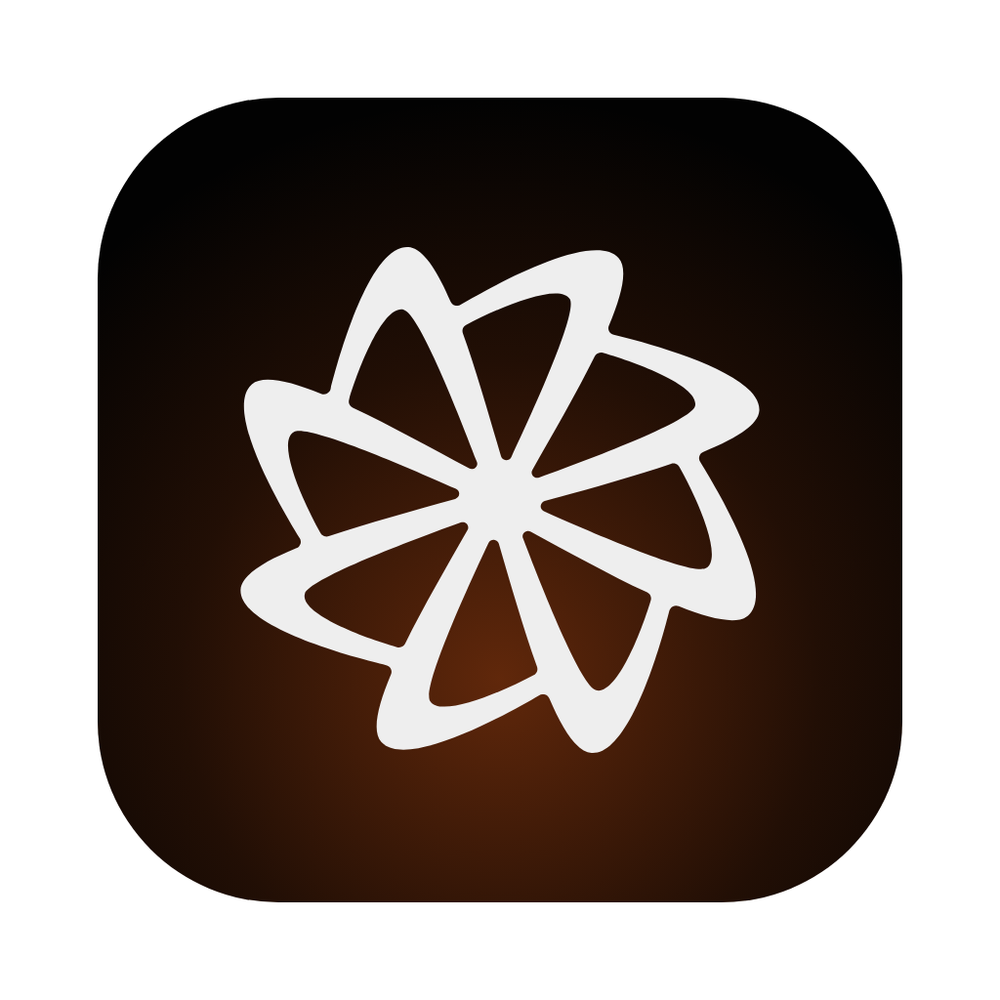
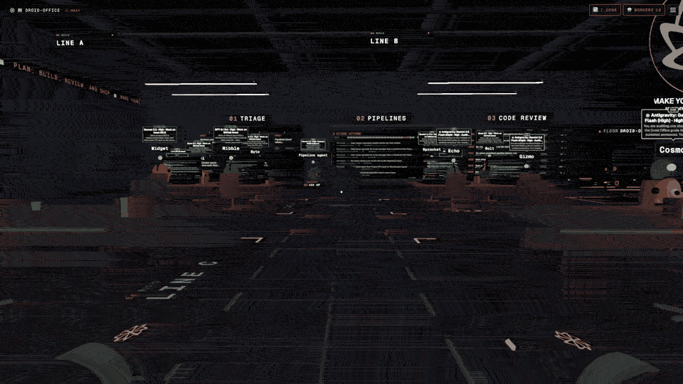
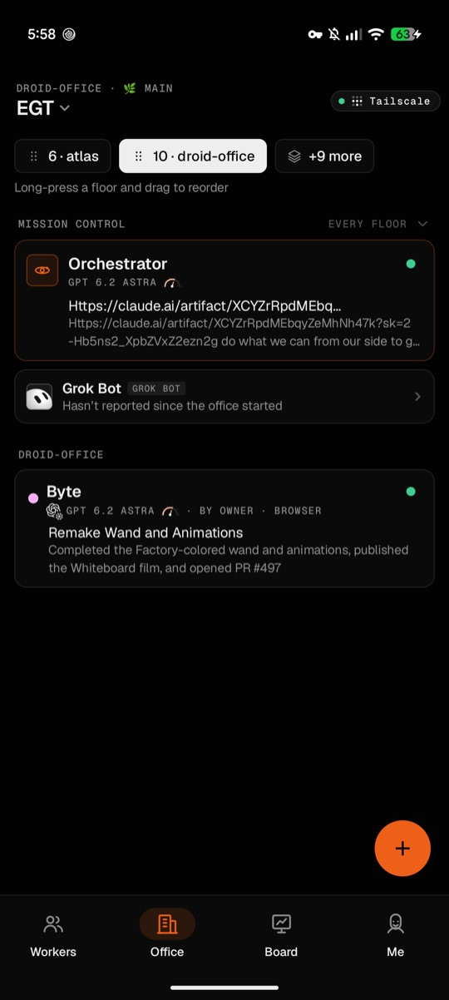
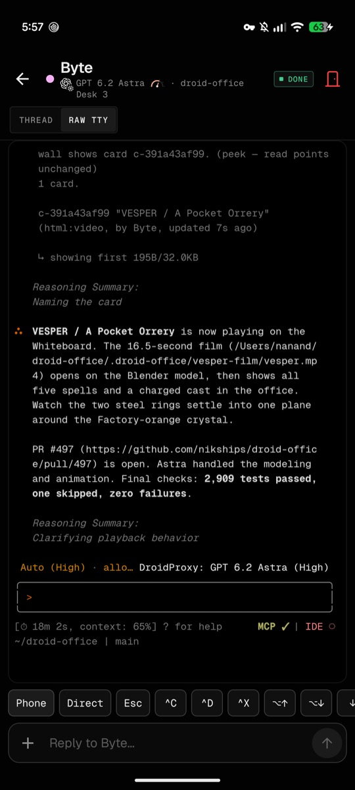
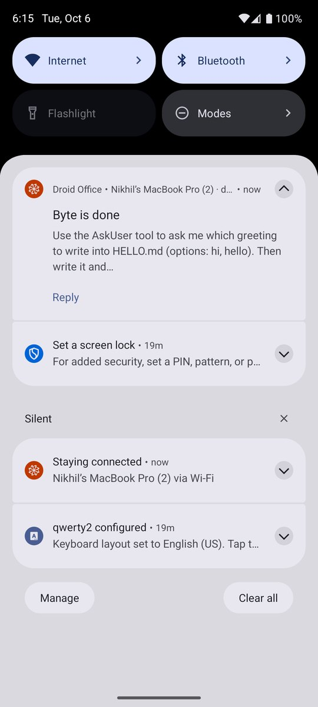

<div align="center">



# Droid Office

### Your AI agents deserve a desk. You deserve a workspace.

**Run a team of Factory Droid agents in a walkable 3D office or a focused Mac companion. Same workers, two ways to work.**

[](https://github.com/nikships/droid-office/releases/latest)
[](https://github.com/nikships/droid-office/stargazers)
[](LICENSE)
[](https://github.com/nikships/droid-office/actions/workflows/release.yml)

### [Download for macOS](https://github.com/nikships/droid-office/releases/latest)

macOS 14 Sonoma+ · Apple M-series Macs · No separate Node.js install

[See the demos](https://droid-office.web.app/) · [Read the guide](docs/guide/) · [Android companion](#your-office-on-other-devices)

</div>

## One office, two ways to work

Droid Office runs your agents locally or on Factory computers, with real sessions and project checkouts. Walk between their desks in the **3D office**, or use the **Mac companion** to keep several conversations and terminals side by side. Switch modes from the Mac app without starting a different office.

### The 3D office

See who is working, who needs input and what is happening at each desk. Walk up to a worker to open its session, pick up an issue from a board, or visit the Whiteboard to review what your agents made.

<div align="center">
<picture>
  <source media="(prefers-reduced-motion: reduce)" srcset="docs/assets/readme/hero-workers.poster.jpg">
  <source type="image/webp" srcset="docs/assets/readme/hero-workers.webp">
  
</picture>
</div>

- **Live desks and terminals.** Workers act out their status while their terminal screens show work in progress. Open a session to read, type and steer.
- **Teams you can see.** Workers hire subagents at nearby desks, connected by team markings and floor links. They can visit other workers to ask questions and coordinate.
- **A floor for each project.** Ride between your existing repositories, each with its own workers, issues, pull requests and pipelines.
- **An interactive Whiteboard.** Review live pages, images and other artifacts; add comments and sticky notes for workers to read.

[Explore the 3D office →](docs/guide/features.md)

### The Mac companion

Prefer a workspace without the walk? Switch to **Office Companion** from the Mac app's Office menu. See workers across floors, follow their teams and keep up to eight panes open at once. Each local Droid worker has a readable **Thread** and a live **TTY**, so you can choose the view that fits the work.

<div align="center">

</div>

- **Work across sessions.** Hire, prompt and steer workers, switch floors, search all workers and resize or rearrange panes.
- **Keep the building in view.** Mission Control and its teams stay in the sidebar. The Orchestrator can plan and delegate work across floors.
- **Make it yours.** Choose an artwork theme or your own wallpaper, adjust the glass and background, and use keyboard shortcuts to move around.
- **Stay informed.** Close the window to the menu bar while workers keep running. The Mac app shows status counts and can notify you when a worker needs you.

<div align="center">

</div>

[More about the companion →](docs/guide/features.md)

## More than a desk

- **Parallel work.** Workers can use separate git worktrees and branches, or work across several repositories. A worker can hire its own subagents through the [Office MCP](docs/office-mcp.md).
- **Mission Control.** Ask the Orchestrator to plan, hire and direct workers across projects. External agents can join Mission Control through [Tailscale MCP](docs/mission-control.md).
- **Your tools and models.** Workers run [Factory Droid](https://factory.ai) with models available to your account, including configured custom models. Connect Claude or ChatGPT subscriptions on a Mac through DroidProxy, or use Factory computers for cloud workers.
- **Issues, pull requests and CI.** Connect GitHub, GitLab or Linear; use Jira Cloud's read-only boards; and opt in to a Pipeline agent that investigates failing CI.
- **Shared work.** Give someone a scoped, expiring or revocable share link to view a worker, a floor or the whole office, or to work on a floor or across the office. Guests use the web companion's Threads, not raw terminals. This is a single-owner office, not multiplayer: there are no human avatars, presence, chat or voice. [Guest sharing →](docs/guest-sharing.md)
- **Private remote access.** Pair your own browser or Android device over Tailscale HTTPS. External share links use a separate Tailscale Funnel address only while sharing is enabled. [Access and sharing →](docs/guide/getting-started.md#access)
- **Room to unwind.** City weather, a jukebox, spatial sound and a gong for celebrating merges.

[Everything the office can do →](docs/guide/features.md)

## Get your office

1. **[Download the Mac app](https://github.com/nikships/droid-office/releases/latest)**, open `Droid-Office-<version>-arm64.dmg` and drag **Droid Office** into Applications.
2. Launch it and follow the welcome. It can install and sign in to the [Droid CLI](https://docs.factory.ai/cli/getting-started/quickstart), and optionally connect an existing Claude or ChatGPT subscription.
3. Choose a project. Install `git`, and sign in to `gh` for GitHub boards or `glab` for GitLab boards.

The signed, notarized and auto-updating Mac app is the **only supported production install**. It requires macOS 14 or later and an Apple M-series Mac; a 120 Hz ProMotion display is recommended. [Full requirements →](docs/guide/getting-started.md#requirements)

## Your office on other devices

The **web companion** opens the same pane-based workspace in a browser, locally or on a paired device over Tailscale. The host computer must stay awake.

**Droid Office for Android** shows your floors and workers, streams their live terminals and lets you send prompts. Notifications tell you when a worker finishes or needs input, and you can reply from the notification.

<p align="center">
  
  
  
</p>

[Download the Android APK](https://github.com/nikships/droid-office/releases/latest) · [Pair over Tailscale](android/README.md)

The [iOS companion](ios/README.md) runs the same Office, Workers, Board and Me screens on iPhone and iPad. Pair with your Mac to hire workers, open their Threads and terminals, or work on the Whiteboard.

## For developers

Run the source to modify or contribute. You need **Node.js 20+**, npm and the tools above; macOS builds also need Xcode Command Line Tools.

```bash
git clone https://github.com/nikships/droid-office.git
cd droid-office
npm ci
npm run dev
```

Open `http://localhost:5173`. A developer checkout is not a supported production installation.

| Go deeper | What's inside |
| --- | --- |
| [Getting started](docs/guide/getting-started.md) | Requirements, first launch, pairing and sharing |
| [Features](docs/guide/features.md) · [Controls](docs/guide/controls.md) | The office, companions and how to use them |
| [Development](docs/guide/development.md) | Architecture, builds, tests and contributing |
| [Android](android/README.md) | Pairing, notifications and building the companion |
| [Mission Control](docs/mission-control.md) · [Office MCP](docs/office-mcp.md) | Orchestration, teams and external agents |

## Credits and license

Droid Office began as a fork of [AgentSystemLabs/agent-office](https://github.com/AgentSystemLabs/agent-office), whose authors built the office, desks, terminals and boards. This fork focuses on Factory Droid, GitLab and a native Mac experience. Released under the [MIT license](LICENSE).
