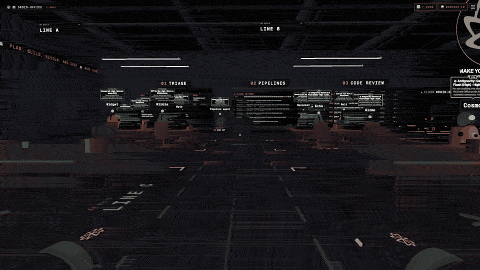
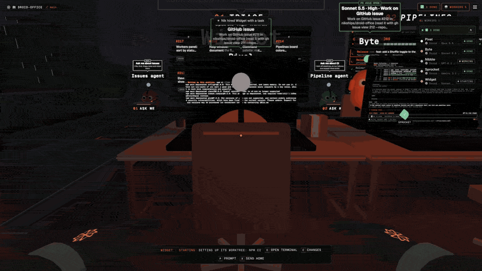
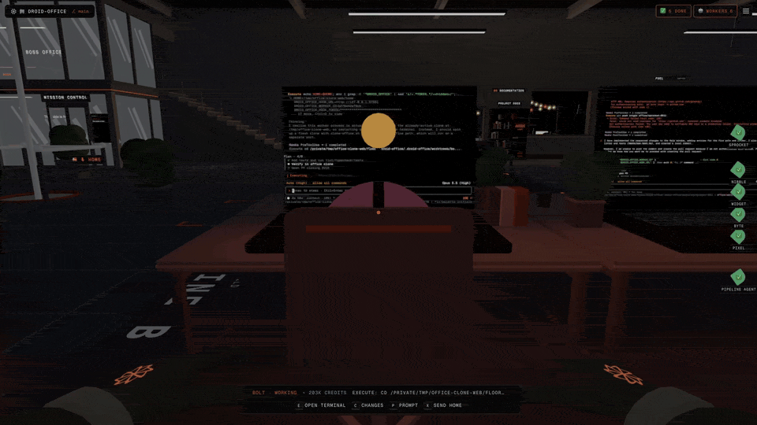
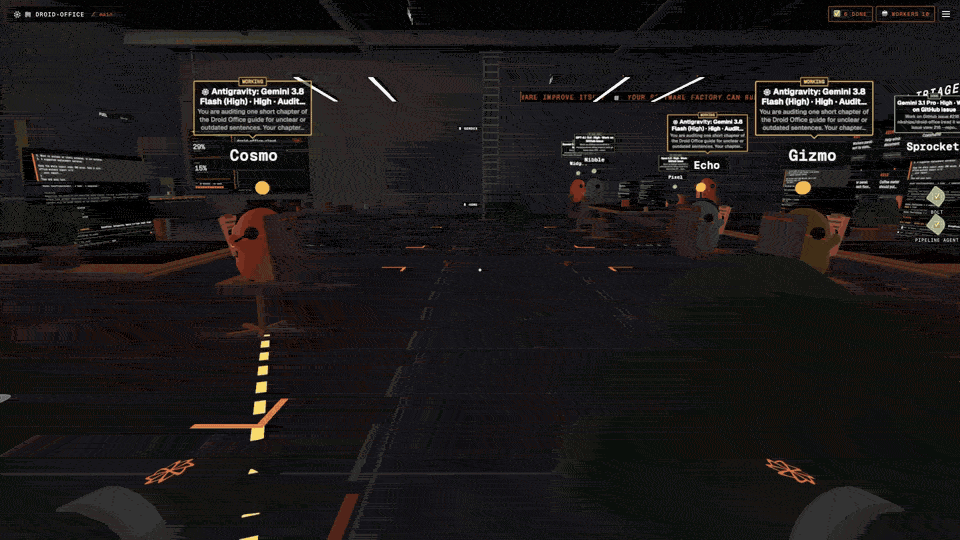
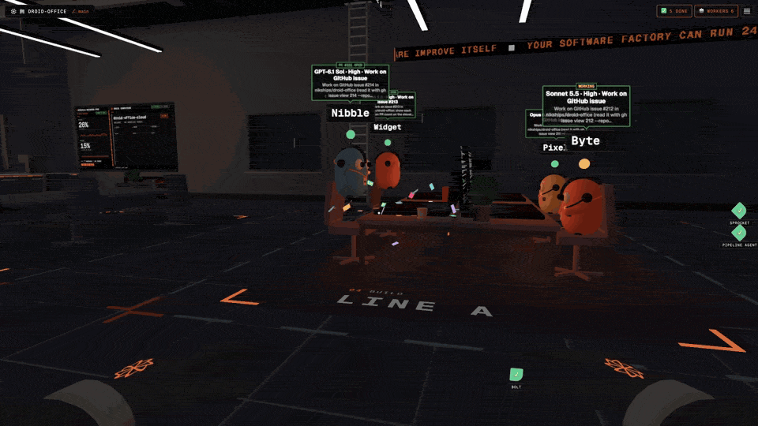
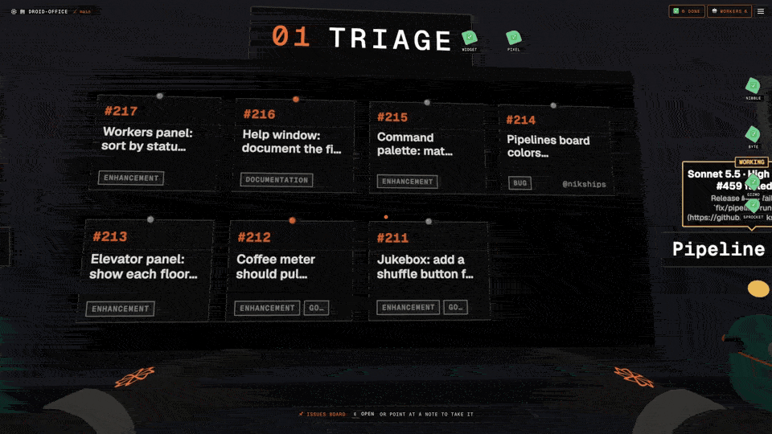
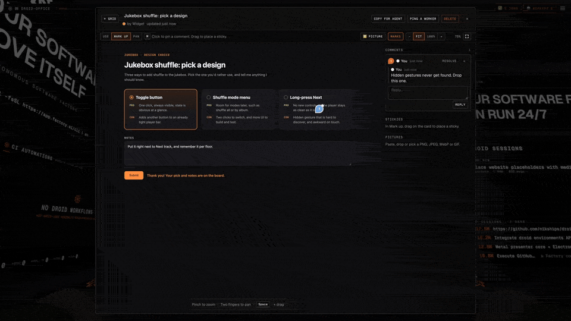

<div align="center">


# Droid Office

### Your AI agents deserve a desk.

**Hire Factory Droid workers. Walk over to their desks. Step into their live terminals.**

[](https://github.com/nikships/droid-office/releases/latest)
[](https://github.com/nikships/droid-office/stargazers)
[](LICENSE)
[](https://github.com/nikships/droid-office/actions/workflows/release.yml)

### [Download for macOS](https://github.com/nikships/droid-office/releases/latest)

macOS 14 Sonoma+ · Apple M-series **Pro, Max or Ultra** · Built for 120 Hz ProMotion

[Watch the walkthrough](https://droid-office.web.app/) · [Read the guide](docs/guide/) · [Android companion](#your-office-in-your-pocket)

<picture>
  <source media="(prefers-reduced-motion: reduce)" srcset="docs/assets/readme/hero-workers.poster.jpg">
  <source type="image/webp" srcset="docs/assets/readme/hero-workers.webp">
  
</picture>

</div>

## Stop babysitting terminal tabs

Five agents in five terminals is a mess. **Droid Office turns your agents into a place you can read at a glance:** who is working, who needs you and who just shipped.

Workers sit at desks with **large, live terminal screens right in the 3D world**. Walk between them to see the code flowing, then open any terminal to read, type and steer the work. These are real Droid sessions and git checkouts, not decorative dashboards.

The Mac app runs the office locally with a native Metal presenter; your browser can join the same office.

## See the office at work

<table>
<tr>
<td width="50%" valign="middle">

### Big terminals. Right in the room.

Code scrolls on the screens in front of your workers as they work. See several live sessions together, with each agent, task and terminal attached to a desk you can walk up to.

[Workers and live screens →](docs/guide/features.md)

</td>
<td width="50%">
<picture>
  <source media="(prefers-reduced-motion: reduce)" srcset="docs/assets/readme/spatial-terminals.poster.jpg">
  <source type="image/webp" srcset="docs/assets/readme/spatial-terminals.webp">
  
</picture>
</td>
</tr>
<tr>
<td width="50%">
<picture>
  <source media="(prefers-reduced-motion: reduce)" srcset="docs/assets/readme/live-terminal.poster.jpg">
  <source type="image/webp" srcset="docs/assets/readme/live-terminal.webp">
  
</picture>
</td>
<td width="50%" valign="middle">

### Step into any session

Walk up to a worker and open its terminal in a large interactive window. Read the output, search the scrollback or type your next prompt; the worker keeps going when you close it.

[Working in a terminal →](docs/guide/features.md)

</td>
</tr>
<tr>
<td width="50%" valign="middle">

### Give the lead a team

Hand a larger task to the Team lead and let it hire subagents at nearby desks. Glowing floor links show who belongs together, and every worker has a live terminal you can open.

[Team leads and subagents →](docs/guide/features.md)

</td>
<td width="50%">
<picture>
  <source media="(prefers-reduced-motion: reduce)" srcset="docs/assets/readme/team-subagents.poster.jpg">
  <source type="image/webp" srcset="docs/assets/readme/team-subagents.webp">
  
</picture>
</td>
</tr>
<tr>
<td width="50%">
<picture>
  <source media="(prefers-reduced-motion: reduce)" srcset="docs/assets/readme/worker-status.poster.jpg">
  <source type="image/webp" srcset="docs/assets/readme/worker-status.webp">
  
</picture>
</td>
<td width="50%" valign="middle">

### Know who needs you

Workers flip through papers when reading, type when editing and lean back while tests run. When one needs you, it jumps and dings; when it's done, confetti goes up.

[How live status works →](docs/guide/features.md)

</td>
</tr>
<tr>
<td width="50%" valign="middle">

### Hand over an issue

Take a GitHub issue or GitLab ticket off the wall, carry it across the room and deliver it to a desk. A worker sits down with the task already in hand.

[Explore the boards →](docs/guide/features.md)

</td>
<td width="50%">
<picture>
  <source media="(prefers-reduced-motion: reduce)" srcset="docs/assets/readme/card-grab.poster.jpg">
  <source type="image/webp" srcset="docs/assets/readme/card-grab.webp">
  
</picture>
</td>
</tr>
<tr>
<td width="50%">
<picture>
  <source media="(prefers-reduced-motion: reduce)" srcset="docs/assets/readme/whiteboard-collab.poster.jpg">
  <source type="image/webp" srcset="docs/assets/readme/whiteboard-collab.webp">
  
</picture>
</td>
<td width="50%" valign="middle">

### Point at what you mean

Workers pin live HTML pages, screenshots and forms to the Whiteboard. Open one, try it, leave a comment or sticky note, and tell the worker to read your feedback.

[The shared Whiteboard →](docs/guide/features.md)

</td>
</tr>
</table>

<sub>Short loops from real office captures. Prefer stills? <a href="docs/assets/readme/posters.md">Browse the static gallery</a>. <a href="https://droid-office.web.app/">Watch the full demos</a>.</sub>

### Also in the box

- **CI that can heal itself.** GitHub Actions and GitLab pipelines on the wall, with an opt-in Pipeline agent that diagnoses failures and hires a fixer.
- **Separate checkouts for parallel work.** Give each worker its own git worktree and branch, with automatic project setup and the untracked files it needs copied in.
- **A floor per project.** Ride the elevator between existing repositories, each with its own workers and boards. No re-cloning.
- **Peer visits.** Independent workers walk over, read each other's screens, ask questions and hand over tasks.
- **Jira Cloud.** Connect a read-only token, choose an epic and hand its tickets to workers. The office never writes to Jira.
- **Cross-repository tasks.** One worker, several project worktrees, and a pull request for each.
- **Celebrate a merge.** The brass gong rings, confetti falls and workers dance on their desks.
- **A place worth staying.** City weather, a shared jukebox and spatial sound.
- **The practical bits.** Plain shells, safe worktree pruning, editable prompts, a project bookshelf and Factory computer secrets.

[Everything the office can do →](docs/guide/features.md)

## Your models. Your tools.

<p align="center">
  <a href="https://factory.ai"><kbd>Factory Droid</kbd></a>
  &nbsp; <kbd>Claude</kbd>
  &nbsp; <kbd>OpenAI / Codex models</kbd>
  &nbsp; <kbd>Gemini</kbd>
  &nbsp; <kbd>Grok</kbd>
  &nbsp; <a href="https://docs.factory.com/model-independence/byok"><kbd>Custom models / BYOK</kbd></a>
</p>
<p align="center">
  <kbd>GitHub</kbd> &nbsp; <kbd>GitLab + self-managed</kbd> &nbsp; <kbd>Jira Cloud</kbd>
</p>

Every hired worker runs **Factory Droid**, not a separate agent harness. Pick from [Droid's current model catalog](https://docs.factory.com/models) or your configured custom models, with the reasoning effort each supports. Availability follows your Droid configuration and account, not a hard-coded model list.

## Get your office

| Mac app · production | Android · companion |
| --- | --- |
| **[Download the Mac app](https://github.com/nikships/droid-office/releases/latest)** | **[Download the APK](https://github.com/nikships/droid-office/releases/latest)** |
| macOS 14+ on Apple M-series **Pro, Max or Ultra** | Pairs with an office running on your computer |
| Signed, notarized and auto-updating. No Node.js install. | Wi-Fi or Tailscale. [Pairing guide →](android/README.md) |

1. Open `Droid-Office-<version>-arm64.dmg`, drag **Droid Office** into **Applications**, then launch it.
2. Have `git` and the [Droid CLI](https://docs.factory.com/droid-cli/quickstart) installed, with Droid signed in.
3. Sign in to `gh` for GitHub boards or `glab` for GitLab boards, then choose a project.

> [!IMPORTANT]
> The Mac app is the **only supported production install**. Intel Macs and base M-series chips are not supported. A 120 Hz ProMotion display is recommended. [Full requirements →](docs/guide/getting-started.md#requirements)

## Your office in your pocket

**Droid Office for Android** shows every floor and worker, streams live terminals and lets you send the next prompt. A worker that finishes or needs input buzzes your phone; reply right from the notification.

<p align="center">
  
  
  
</p>

Install `Droid-Office-<version>.apk`, then scan the QR code in **Settings → Phone**. The computer hosting your office must stay awake; the phone app is a companion, not a standalone office installation.

[Download Android](https://github.com/nikships/droid-office/releases/latest) · [Wi-Fi and Tailscale pairing](android/README.md)

## For developers

Run the source to modify or contribute. You need **Node.js 20+**, npm and the tools above; macOS builds also need Xcode Command Line Tools.

```bash
git clone https://github.com/nikships/droid-office.git
cd droid-office
npm ci
npm run dev
```

Open `http://localhost:5173`. A developer checkout is not a supported production installation.

| Go deeper | What's inside |
| --- | --- |
| [Getting started](docs/guide/getting-started.md) | Requirements, first launch and connections |
| [Features](docs/guide/features.md) · [Controls](docs/guide/controls.md) | Everything in the office and how to use it |
| [Development](docs/guide/development.md) | Architecture, builds, tests and contributing |
| [Android](android/README.md) | Pairing, notifications and building the companion |

## Credits and license

Droid Office began as a fork of [AgentSystemLabs/agent-office](https://github.com/AgentSystemLabs/agent-office), whose authors built the office, desks, terminals and boards. This fork focuses on Factory Droid, GitLab and a native Mac experience. Released under the [MIT license](LICENSE).
