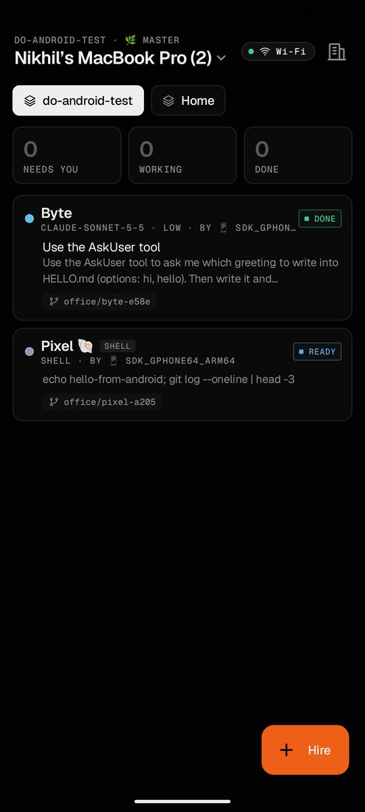
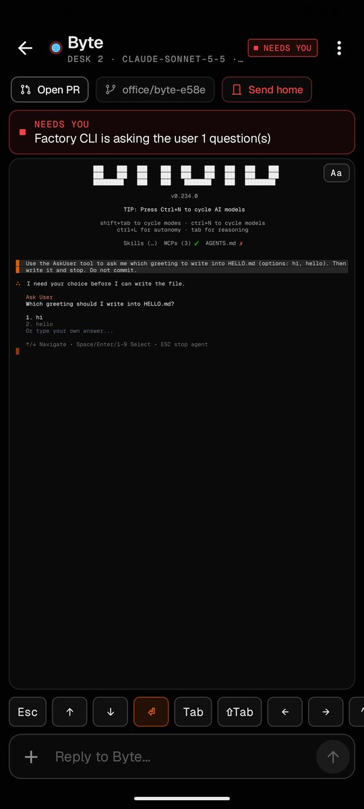
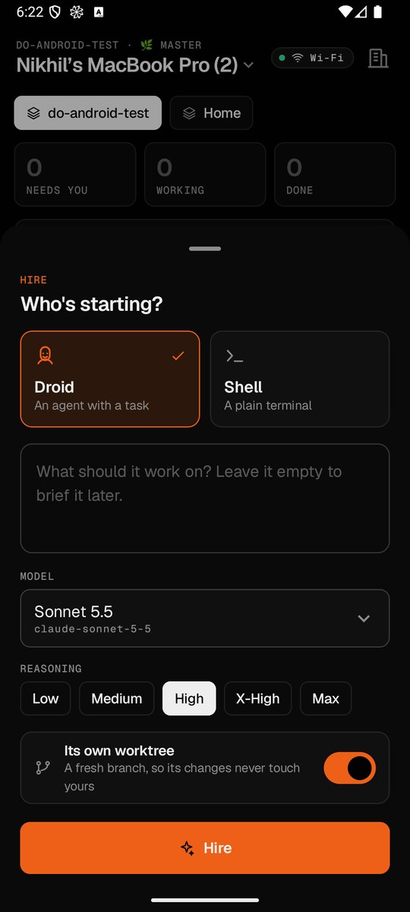
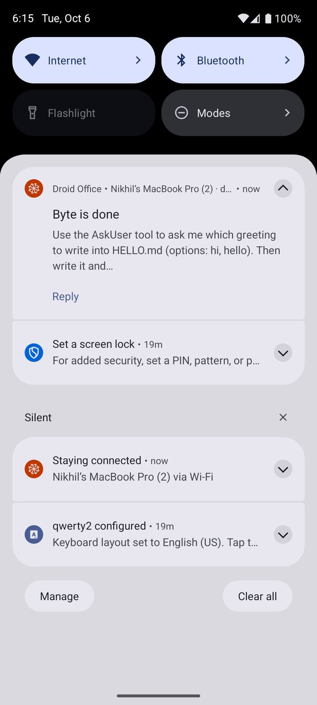
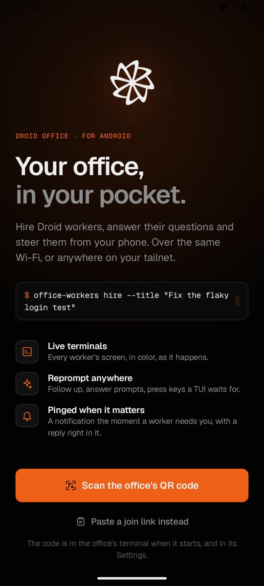
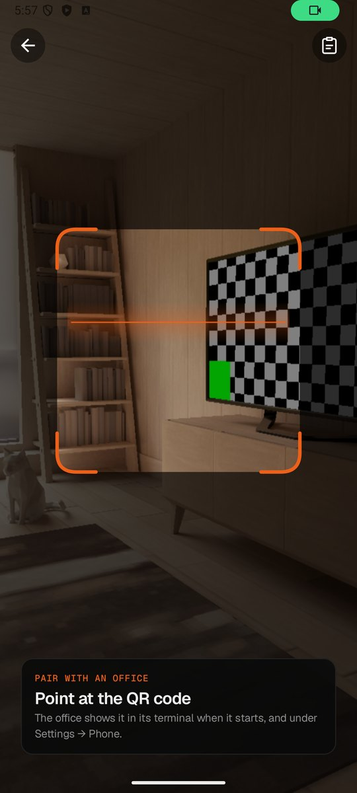
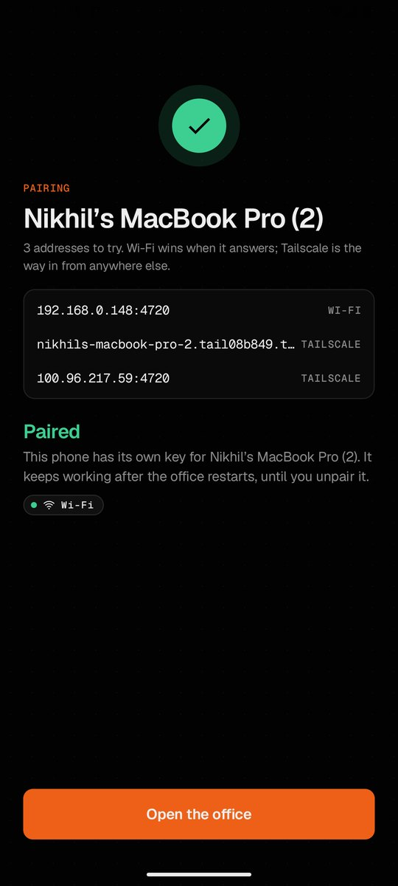
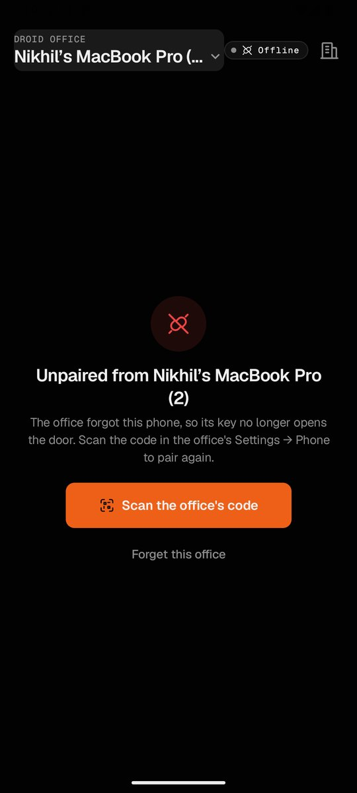

# Droid Office for Android

A companion app for your phone. Pair it with your office once, and from anywhere on your Wi-Fi or your tailnet you can see every worker, hire new ones, watch their live terminals, prompt them, and read and comment on the floor's Whiteboard.

<p>
  
  
  
  
</p>

## What it does

- **Pair with a QR code.** Open ⚙️ Settings → **Phone & web** in the office on your computer, choose **📱 Pair a phone** and scan the code. The app also takes the join URL's QR code from the office's terminal, a `droidoffice://pair` link, or a pasted link.
- **Asks.** The first tab is every question a worker is waiting on, the one that has waited longest first. Each is a card with the worker, its floor and branch, what it's on, the question Droid's AskUser shows, its numbered choices (with the line under each) as big buttons, and **Or type your own answer…**. Tap a choice and it waits 3 seconds as **Sending to Atlas… Cancel**; then the app reads the worker's screen again and sends the keys only if it still shows the same question, and opens the worker instead when it changed. A typed answer moves Droid's highlight to its own-answer row and types the text only once Droid's hints say that row is selected (otherwise the worker opens with your text in the composer). There is no Skip: Esc stops the agent. **Wait before sending** under **Me** turns the 3 seconds off. With nothing waiting it says so, with who is still working. The tabs are **Asks**, **Office** (the worker list), **Board** (the Whiteboard) and **Me** (offices and settings); on a tablet they are a rail down the side.
- **Every worker, every floor.** Workers are grouped by floor, the ones that need you first, with what each is doing, its desk and its branch. Pull down to refresh. Subagents sit under their lead. Long-press a numbered floor chip and drag it sideways to reorder floors, holding at an edge to scroll. Accessibility actions move a floor earlier or later. The order is saved by the office and changes desktop Command+number shortcuts too.
- **Live terminals.** A worker's real PTY streams into a terminal emulator on the phone (xterm.js, the one the office's own terminals use), with the scrollback the office sent. It has two views. Opening a worker starts in **Phone**, which resizes the actual PTY's columns and rows for readable phone-sized text, so programs wrap and redraw for your screen; opening the keyboard changes only the rows, and rotating the phone fits it again. Tap **Phone** in the quick keys to switch to **Desktop**, which shows the terminal at the size your desktop gave it, scaled to fit the screen, and never changes that size; the size from before goes back, as it does when you leave the terminal. Tap **Phone** again to return to the phone's size. If a desktop window resizes the terminal while you're in Phone, the phone gives way and switches to Desktop. A cloud worker has no terminal here, so it stays on Desktop. Swipe to scroll back through earlier lines, and flick to keep going; **Latest** brings you back to the bottom. In a full-screen program (`less`, `htop`, an editor) a swipe scrolls the program instead: it gets wheel events when it reads the mouse, arrow keys otherwise. Text on the terminal can't be selected. Use Android's screenshot text selection to copy it.
- **Prompt and type.** The composer sends a prompt to a Droid worker, with up to 10 photos attached. Turn on **Queue** next to send and the next Send submits the message the way Ctrl+Enter does in a desktop terminal, so Droid takes it after what it's working on now; it turns itself off after that send. A shell worker gets a single command line. In **Raw TTY**, tap **Direct** beside **Phone** to hide the composer and type straight into the terminal: each letter, Backspace and Enter goes to the live PTY immediately, including edits from a composing keyboard. Tap the terminal to bring its keyboard back, or turn **Direct** off to return to the composer with your draft and pictures untouched. Hardware keyboards work too, including Ctrl and Alt shortcuts. The quick keys under it send Ctrl+C, Ctrl+D, Ctrl+X, Option+Up, Option+Down, the arrows, Enter, Tab, Shift+Tab, Esc, Backspace and `/`. A shell worker's row has Phone and Direct, then Tab and one-tap commands instead: `git status`, `git fetch`, `git pull`, `git add .`, `git push`, `git diff`, `ls`, `cd ..` and `clear`, each clearing the half-typed line and pressing Enter; that row has no arrange button. On a Droid worker the sliders button at the end of the row opens **Arrange the keys**: drag a key by its handle or move it with its arrows, and **Reset to default** puts the order back. Phone and Direct stay first. The phone keeps the order through app updates, and a key a later release adds appears next to the key it follows by default. A worker opens in **Raw TTY**, the terminal itself with the quick keys, unless you last picked **Thread** on a worker or a connected local Droid worker is waiting on a question with a readable answer menu. Picking Thread is remembered across visits and app restarts until you pick Raw TTY again; workers opened with a draft answer to type always start in Raw TTY. The **Thread** is the worker's conversation, read by the office from its Droid session: your messages and its replies (Markdown, selectable for copying), with everything it did between two messages folded into one quiet line that says what it did ("Read 3 files · Ran 2 commands"). Tap the line for one row per action in plain words (the command's own summary, the file it read, what it searched for), its thoughts and the plan as that run left it; tap an action for its command, script or arguments and its result. The thread leaves out the agent's bookkeeping (successful TodoWrite, ToolSearch and Skill calls, script wrappers whose calls are listed anyway, plan snapshots and turns that ended normally); anything that failed stays, with the failure shown under the line even while it is closed, and a call that never got a result says so instead of looking done. A cancelled or failed turn is a notice of its own. In the Thread view, the Thread and Raw TTY switch shares the row with the PR and branch, and the Send home icon is in the header. It shows the latest 100 entries and refreshes once a second while it is on screen and connected; **Load earlier** at the top fetches older ones without moving what you are reading, and new messages scroll into view only while you are at the bottom, and opening a run never scrolls it away (the button at the bottom says how many new messages came in, or **Jump to latest**, and takes you back). A run that only thought is its thoughts, each one line that opens to the whole thought. When the session is rewound or rewritten, the entries it dropped leave the thread too. Up to 2,000 entries stay loaded: the oldest go as new ones arrive (Load earlier brings them back), and loading earlier past that lets the newest go until **Back to the latest**. The live activity group shows what is running; Thread omits the duplicate activity footer and raw terminal line. The question it is waiting on stays a card with its choices. While it waits on a question, the composer gives way to a note to answer it first, so a message is never typed into the question; a question the phone can't read says to answer it in Raw TTY. A slash command typed in the thread isn't sent: the app switches to Raw TTY with it still in the composer, since Droid runs those in its terminal. An office from before threads, or a session it can't read, says so with **Try again** and **Raw TTY**, and so does a lost connection. The thread never resizes the shared terminal: the Phone view applies only in Raw TTY. In Raw TTY, when a worker shows a numbered menu (AskUser, a folder-trust prompt), its choices appear as buttons above the terminal; tapping one sends the keys that pick it.
- **The Whiteboard.** The **Board** tab is the current floor's [Whiteboard](../docs/whiteboard.md): every card newest first, as the office renders it, with who made it, when it changed, its open comments, and an orange mark on each card someone else changed since you looked (the tab's badge counts them). Pull down to fetch it again. Tap a card to open it live, as the office's window shows it: the card runs in the same sandboxed frame, so its videos play, its forms, buttons and links work, and what it records reaches the board (a recorded action says so, with **Ping a worker** to tell one now). Pinch to zoom. **Use** is for the card itself; in **Mark up** a tap pins a comment there and a long-press places a sticky note, while a drag scrolls the card. Tap a sticky to write on it, change its colour, move it to another spot or delete it, and drag it or its corner to move or resize it; the picture button adds a photo from your phone at the middle of the view. Pins, stickies and pictures sit where the office puts them, following the element they're attached to. **Comments** lists the card's threads, open ones first, where you reply, resolve and reopen, **Show** one on the card or **Move** it to another spot; it lists the sticky notes too. Threads and notes changed since you last looked are marked New, with an orange ring on the card. The full-screen button hides everything but the card, and a card video's own full-screen button fills the phone with the video until you press Back or leave it from the video's controls. Rotating the phone keeps the card, and a playing video, where it was. A card that can't load because the office is out of reach says so, with **Try again**. Opening a card marks it read, as the office's own panel does. The wall icon puts the card on the office's wall (or the grid back), and **Ping a worker** asks one of the floor's workers to read the board, as its status allows: the sheet says why one can't take it now. On a phone whose WebView is too old for the live card, or an office from before card capabilities, the card shows as the office renders it instead: pinch or double-tap to zoom, and long-press the page to pin a comment. The grid's thumbnails are always the office's renders (it downloads its Chromium on first use, and the tab says why when it can't render), and the board can't change while the office is unreachable.
- **Hire from your phone.** Pick Droid or Shell, a first prompt, a model and reasoning effort, and whether it gets its own git worktree on a project floor. Home and plain folders do not show the worktree switch. Search the model sheet by name, provider or id, ignoring punctuation; matching words light up. Filter with All, Yours, provider and Legacy chips. Your models group by gateway, Factory's by provider, with your four recent picks first. Rows show the model family's own LobeHub logo, Factory credit multipliers and capability/promotion labels. An id not in the list can be used as typed. The sheet starts on the model and effort you hired with last. A model of your Claude, ChatGPT or other plan that can't run now (out of quota, no account connected, its provider switched off, DroidProxy not installed) is dimmed with the reason and can't be chosen; a stopped DroidProxy only adds a quiet note, since the office starts it. The office seats it at the first free desk, then the first free bean bag.
- **Subscriptions.** **Me → Subscriptions** shows the paired office's DroidProxy status, provider accounts, usage left and reset times, and whether its model list needs updating. Logos identify each plan. This view is read-only; manage sign-ins, accounts and installation in **Settings → Connections** on the office's Mac. An older office without subscription status says so.
- **Run the floor.** Resume a sleeping worker, ask a worker on a branch to open its pull request (or open the one it has), or send it home (keeping or deleting its worktree and branch).
- **Notifications with replies.** When a worker needs you or finishes, the phone notifies you (a subagent finishing doesn't: its lead reads that), and quietly updates the notification when the office fills in what it's asking. When the phone can read the question on the worker's screen, the notification shows it with its choices and has buttons for the first two; **Reply** takes a choice's number or your own answer. Either is checked against the worker's screen first, like an answer from Asks, and the notification then says whether it went. Otherwise a reply goes straight to that worker as a prompt. The app asks for notification permission once, right after pairing; after that, **Allow** under **Me** opens the system prompt or, once Android stops showing it, the app's notification settings. Turn on **Stay connected** to keep the connection open while the app is in the background; otherwise notifications only arrive while the app is open or shortly after.
- **More than one office.** Pair a laptop and a server and switch between them under **Me**. **Rename** on an office is only on this phone: the office keeps its own name, and the one you chose stays through app updates and reconnects. Leave it blank to show the office's name again.
- **Update from the app.** A quiet check when you open it tells you when a newer Android app is available. Under **Me → About**, tap **Update app**, then **Update now** to download it with progress and open Android's installer. The welcome screen has the same control before pairing. Downloads start only when you ask, can be cancelled, and keep going if you tap **Keep using app**.
- **Update the host Mac.** **Me → About → Host desktop app** checks the Mac app that runs the active office. Confirm **Install and restart** to download its signed update, follow progress, and restart the host while workers keep running. The phone reconnects automatically. Closing the sheet does not cancel the host update. Checkout hosts and older offices explain why remote updates are unavailable; update an older office on its Mac first.
- **Tablets and foldables.** On a tablet or an open foldable, **Office** is the floor as a live 3D map, the web companion's Overview: every worker at its real desk with its terminal on its laptop and a name tag over its head, beside a roster of the floor's workers. Tap a worker in the roster, or tap one on the map to see its card and tap again, and the camera flies in to its desk and opens its terminal over the map; Back pulls out to the floor again. Tap a free desk to see it and again to hire there (the hire sheet says which desk). Drag to look around, pinch to zoom, and the dock's buttons show the whole floor, zoom out, zoom in and hire. Held upright, the roster runs along the bottom. Half open, a foldable keeps the map off the fold: above it with the roster and controls below, like a laptop (tabletop), or on one page with the roster on the other, like a book. The list button switches to the worker list, where on a wide screen the list and the terminal sit side by side; the map button goes back. Phones, upright or sideways, and a foldable's cover screen keep the list, and so does a tablet whose WebView can't draw WebGL 2. On a wide screen the tabs are a rail.

<p>
  
  
  
  
</p>

## Install it

You need Android 9 or newer and an office new enough to pair phones (one whose ⚙️ Settings has a **Phone** category).

1. Download `Droid-Office-<version>.apk` from the [latest release](https://github.com/nikships/droid-office/releases/latest) on your phone.
2. Open it and allow your browser or file manager to install apps when Android asks.
3. Open **Droid Office**, tap **Scan the office's QR code**, and scan the code from ⚙️ Settings → **Phone & web** on your computer.

The APK keeps its original version when a Mac-only release carries it forward unchanged. The app offers an update only when a newer Android APK is available. Installing it over the old keeps your paired offices.

### Update it

The app checks the public [latest GitHub release](https://github.com/nikships/droid-office/releases/latest), independently of the office you're paired with. It checks when it comes to the foreground, at most once an hour in a running app (15 minutes after a failed check). **Check for updates** under **Offices → About**, or on the welcome screen, checks immediately.

When an update is available, tap **Update app → Update now**. It downloads and verifies the APK, then opens Android's installer. The first time, Android asks you to allow installs from **Droid Office**; enable **Allow from this source** and return to the app to continue. Confirm the update in Android and reopen Droid Office. Your offices, keys and settings stay put. This is not an unattended background update.

Cancel the installer and **Install update** tries again without downloading again. A finished download can also be reused after the app restarts, after its size, checksum and package are checked again. A download interrupted by process death restarts on the next **Update now** tap. If the phone is offline, GitHub is rate limited, the APK isn't ready, or in-app installation isn't possible, **Download newest version** opens the latest release in your browser. Debug builds offer that link instead of trying to replace themselves with the differently named release app.

The updater uses only HTTPS, no GitHub login or office token. Before installation it checks GitHub's SHA-256 digest, the package name, version code, Android requirement and the installed app's signing key. The APK is kept in private cache and shared read-only with the installer; no storage permission is needed. See [the update design and research](docs/updates.md) for the alternatives and platform limits.

## How it connects

- **Wi-Fi first, then Tailscale.** The pairing code lists the office's Wi-Fi addresses, then its Tailscale MagicDNS name and `100.x.y.z` address. Each time it connects, the app asks every address at once and uses the first that answers, but waits a moment (600 ms) for a Wi-Fi address still in flight before settling for Tailscale. It races again whenever the phone's network changes, so walking out of the house moves it to Tailscale on its own. While it is on Tailscale it asks the Wi-Fi addresses again every 30 seconds, and moves back as soon as one answers (after a Wi-Fi blip nothing about the phone's network changes). For Tailscale, sign the phone in to the same tailnet as the office's machine.
- **Device token.** Pairing trades the office's one-time LAN token for a device token of its own (`POST /api/mobile/pair`), so the phone stays paired when the office restarts. Pairing an office the phone is already paired with replaces the old entry and hands the office back the old token, so the office lists the phone once. Pairing runs in the app's scope, so rotating the phone mid-way doesn't pair twice. The app sends it as `Authorization: Bearer` on every request and on the WebSocket. Against an office from before phone pairing, the app falls back to the LAN token in the link, which stops working when that office restarts.
- **Forgetting a phone.** **Forget** next to the phone in the office's Phone window, or **Forget** next to the office under **Offices** in the app, unpairs it. When the office refuses its token (a `401`, or the WebSocket closing with `4401`), the app stops reconnecting and shows **Pair again**.
- **Reconnects.** A dropped connection retries after 1 s, 2 s, 4 s … up to 30 s. The app keeps its connection while it is on screen, while **Stay connected** is on, or while it sends a notification reply, and closes it 20 seconds after the last of those ends.

## Security

- The device token is as good as a shell on the office's machine. The app keeps it encrypted with an AES-256-GCM key in the Android Keystore (hardware backed where the phone has it), and turns off Android's cloud and device-to-device backups, so a new phone pairs again.
- An office serves plain HTTP on its LAN and tailnet addresses, so the app allows cleartext, but only to private addresses: loopback, link-local, RFC 1918, Tailscale's `100.64.0.0/10` and IPv6 unique-local. `net/CleartextGuard.kt` checks the address each connection actually reached, before any of the request is sent. An office on a public address needs HTTPS. Only the system's certificate authorities are trusted.
- The 3D map is a WebView showing a page bundled in the app (`assets/overview/`, built from the office's own map code). The app hands it the floor, its workers and their screens. Its 3D models, fonts and model logos come from the office's open `/props/`, `/fonts/` and `/icons/models/` routes, which carry no office data; the app fetches them with its own client, so the page never sees the office's address or a token. Every other request it makes is answered with a 404, it can't navigate away, and it has no file or content access. Native model logos are bundled in the APK, with LobeHub's MIT attribution: 128px PNGs rendered from the same official colored SVGs, including their gradients and masks. Only marks with no colored variant are tinted for contrast.
- The terminal is a WebView showing a page bundled in the app (`assets/terminal/`), served by `WebViewAssetLoader`. Every other request it makes is answered with a 404, it can't navigate away, and it has no file or content access. Terminal output reaches it through the app, never from the network. The page sends the app only touch scrolls; direct typing uses a native Android input connection, so xterm's terminal-query replies are never forwarded to the PTY.

## Build it

You need JDK 17 or newer (CI uses 21) and the Android SDK with platform 37. Android Studio provides both; on the command line, point `ANDROID_HOME` at the SDK or write `sdk.dir=<path>` to `android/local.properties`.

Run from `android/`:

| Task | Command |
| --- | --- |
| Unit tests | `./gradlew testDebugUnitTest` |
| Lint (any error fails) | `./gradlew lintDebug` |
| Debug APK (`ai.factory.droidoffice.debug`, installs next to a release build) | `./gradlew assembleDebug` |
| Install the debug APK on a connected phone or emulator | `./gradlew installDebug` |
| Release APK, minified with R8 | `./gradlew assembleRelease` |

The release APK is signed with the keystore in `ANDROID_KEYSTORE_FILE`, `ANDROID_KEYSTORE_PASSWORD`, `ANDROID_KEY_ALIAS` and `ANDROID_KEY_PASSWORD` when they are set, and otherwise with the machine's debug key (`~/.android/debug.keystore`, which the Android build creates the first time it needs one). A debug-signed APK installs, but Android only updates an app with an APK signed by the same key. `-PofficeVersion=0.1.123 -PofficeVersionCode=123` sets its version.

After changing the web's model-logo mapping or SVGs, run `node --import tsx tools/android-model-icons.mjs` from the repository root (with the office's Chromium installed) and commit the generated PNGs and manifest. Android's own build needs neither Node nor an SVG decoder.

To try it against a local office from an emulator, start the office (`node bin/droid-office.js <project>`), open ⚙️ Settings → **Phone & web**, and pass the link to the emulator; `10.0.2.2` is the host machine:

```bash
adb shell "am start -a android.intent.action.VIEW -d 'droidoffice://pair?v=1&name=My%20Mac&t=<token>&u=http://10.0.2.2:4600'"
```

## Drive it with adb

In Thread, the list follows the newest entry and stays at the bottom through new entries, a queued turn, the question card and font, density or window changes. Scrolling up stops following until you scroll back to the bottom. Opening a run, a call's details, a thought, a long message or the receipts brings what opened into view and stops following until you ask: back at the bottom the strip (`worker.thread.jump`) reads **Follow latest**, further up **Jump to latest**, and tapping it, or sending a message, follows again. What is open, whether it follows and where you were reading survive a font, density or theme change recreating the screen. Wide code and Markdown tables (`worker.thread.table`, columns lined up, scrolling sideways as one) show a short fade and a chevron at the right edge while there is more to the right (`worker.thread.code.hint`, content-desc "Scrolls sideways"). The question card shows the question its ask call wrote when the screen's line doesn't end in a question mark, never the CLI's "is asking the user 1 question(s)" notice. While a turn runs, `composer.stop` stops it with Esc, the same key as Raw TTY's `key.escape`, which is now first in the quick keys by default. With the keyboard open the composer shows three lines and scrolls the rest of the draft. Offline, Send and Queue are off, the draft stays, and nothing is sent later on its own: the one notice under the header (`worker.offline`) says the screen or thread is the last the office sent, with `composer.offline` saying Send is off, and the status pill is hidden until the phone reaches the office again. The worker's model, effort and desk under its name wrap onto a second line between parts rather than being cut off, and no line starts or ends with a separator dot. Table cells break only between words, never inside inline code: a cell is as wide as its longest command, and the table scrolls sideways. Raw TTY lifts text too dark to read against its background (minimum contrast 4.5:1), such as the key names in Droid's queue hint. Both views share one band under the header: the Thread and Raw TTY switch, then the PR and branch; The Send home icon is in the header.

A queue request sent during a busy turn leaves a receipt as the last item in the thread (`worker.thread.queued`): one line, **Queue request sent · 2** (`worker.thread.queued.summary`), opened with `worker.thread.queued.toggle` (`checked` is open) to what's known about delivery, **Open Raw TTY**, **Dismiss receipt**, and the messages themselves. This confirms only that the phone handed a frame to its socket, not that Droid received or kept it. Web waits for the office's action confirmation, but neither client receives current queue state. A later exact matching user message, including consecutive queued messages concatenated by Droid, confirms delivery and clears the receipt. Mixed-in text from another client or an image can prevent an exact match, so an unconfirmed receipt is not proof of nondelivery: once the turn ends it says **Delivery isn’t confirmed here. Check Raw TTY before sending again.** A send before history has loaded also stays unconfirmed rather than matching an old message. **Open Raw TTY** (`worker.thread.queued.raw_tty`) only switches views. **Dismiss receipt** (`worker.thread.queued.dismiss`) clears this phone's receipt without touching Droid's queue. Receipts survive switching views, rotation, a restart or a force-stop: while unconfirmed they're kept in a file per worker (not backed up; at most 12 workers, least recently written dropped first, each up to 32 receipts), and forgotten once confirmed, dismissed, on a new session, or when the office is forgotten. Receipts made while the phone reads them back join them. If they can't be kept or restored, `worker.thread.queued.unsaved` says so under the line, even while it is closed. Owner-cancelled tool execution is **Cancelled**, not a red failure; the underlying error remains in its details.

Every screen and control has a stable name from [`core/Tags.kt`](app/src/main/java/ai/factory/droidoffice/core/Tags.kt), which `uiautomator dump` prints as the node's `resource-id`. An agent can see where the app is and tap a control by name instead of by its text or position:

```bash
# What's on screen: each tagged node with its text and bounds.
adb exec-out uiautomator dump /dev/tty | sed 's/<node /\n<node /g' | grep 'resource-id="[^"]'

# Tap a control: take the centre of its bounds="[l,t][r,b]".
adb shell input tap 672 2577
```

- **Where you are.** The screen's root is one of `screen.welcome`, `screen.scan`, `screen.pair`, `screen.home`, `screen.worker` or `screen.offices`, and once paired the tabs `screen.asks`, `screen.home` (Office), `screen.board` and `screen.me`, switched with `tab.asks`, `tab.office`, `tab.board` and `tab.me` in `tab.bar` (the Asks tab's badge has the content-desc "2 waiting", the Board tab's "3 changed"). An open Whiteboard card is `screen.board_card`. On a tablet or an open foldable, the Office tab is `screen.overview` (the 3D map) instead of `screen.home`. A sheet or dialog adds its own root: `hire.sheet`, `hire.model_sheet`, `paste.sheet`, `send_home.dialog`, `forget.dialog`, `offices.rename_dialog`, `board.comments_sheet`, `board.sticky_sheet` or `board.ping_sheet`.
- **Dynamic names.** A name with an id in it has the id after a `/`: `home.worker/<workerId>`, `home.floor/<floorId>`, `hire.model/<modelId>`, `hire.model_why/<modelId>`, `hire.effort/<effort>`, `worker.choice/<number>`, `worker.thread.entry/<entryId>`, `worker.thread.toggle/<entryId>`, `worker.thread.group/<firstEntryId>` (and `.toggle`, `.summary`, `.error`, `.plan`), `send_home.option/all|worktree|keep`, `offices.office/<officeId>`, `offices.name/<officeId>`, `offices.rename/<officeId>`, `offices.forget/<officeId>`, `composer.remove_image/<n>`, `board.card/<cardId>`, `board.thread/<threadId>`, `board.thread.reply/<threadId>`, `board.thread.reply_send/<threadId>`, `board.thread.resolve/<threadId>`, `board.thread.show/<threadId>`, `board.thread.move/<threadId>`, `board.sticky/<stickyId>`, `board.sticky.color/<color>`, `board.ping/<workerId>`, `overview.worker/<workerId>` and `worker.keys_sheet.key|up|down/<keyId>`.
- **Asks.** The card is `asks.card`, with `asks.card.worker`, `asks.card.context`, `asks.card.question`, a button per choice `asks.card.option/<n>` (its content-desc is the number, label and description), `asks.card.own_answer` (the dashed row, then the text field) with `asks.card.own_answer.send`, `asks.card.open_thread`, and `asks.card.waiting` when the question can't be read. `asks.count` is the waiting pill, `asks.next/<id>` a queued worker, `asks.sending` and `asks.sending.cancel` the answer on its way, `asks.answered` an answer that went, and `asks.empty` with `asks.empty.hire` the empty state.
- **Home.** Each worker card is `home.worker/<id>`. Inside it are `home.worker.name`, `home.worker.status` (its content-desc is the status: "Needs you", "Working", "Ready", "Done", "Asleep"), `home.worker.meta`, `home.worker.title` and `home.worker.detail`. The other names on this screen are `home.hire`, `home.hire_first` (on an empty floor), `home.list` (swipe it to scroll), `home.loading`, `home.route` (content-desc "Connected over Wi-Fi" and so on), `home.connection`, `home.retry`, `home.pair_again` and `home.offices`.
- **The map.** `screen.overview` is the 3D floor on a tablet or an open foldable. `overview.map` is the WebView (its content-desc is the floor's name; the map's own name tags show up under it as buttons), `overview.loading` covers it until the floor is in, and `overview.layout`'s content-desc is the layout in use: `side`, `bottom`, `tabletop` or `book`. The roster is `overview.roster` (or `overview.empty`), each worker in it `overview.worker/<id>`; tapping one opens its terminal over the map as `overview.terminal`, with `screen.worker` inside. The rest are `overview.offices`, `overview.route`, `overview.list` (to the worker list), `overview.recenter`, `overview.zoom_out`, `overview.zoom_in` and `overview.hire`, plus the `home.floor/<id>` chips. On the list, `home.map` goes back to the map. To try the layouts on an emulator, `adb emu posture 2` half opens a foldable, `adb emu rotate` turns it between book and tabletop, and `adb emu fold` and `adb emu unfold` close and open it.
- **Floor order.** Long-press and drag `home.floor/<id>` horizontally to change its number. `home.floor_order_hint` names the instruction below the chips. Dragging to an edge scrolls the strip; a short swipe only scrolls.
- **A worker.** `worker.terminal` has the whole terminal screen as its `text` attribute, so a dump reads it without a screenshot. `worker.status`, `worker.name` and `worker.meta` describe the worker. `worker.view.thread` and `worker.view.tty` switch the view (`selected` is the one showing). The thread is `worker.thread`: its conversation is the lazy list `worker.thread.list` (swipe it to scroll), each message or notice `worker.thread.entry/<entryId>`. A message from the owner longer than eight lines shows its start, with `worker.thread.more/<entryId>` to show all of it (`checked` is all of it) and show less again. Each run of work between messages is `worker.thread.group/<firstEntryId>` (the id of the run's first entry, shown or not), opened with `worker.thread.group.toggle/<firstEntryId>` (`checked` is open), with its line `worker.thread.group.summary/<firstEntryId>`, what failed `worker.thread.group.error/<firstEntryId>` (shown while closed) and, when open, its plan `worker.thread.group.plan/<firstEntryId>`. Inside an open run each action or thought is `worker.thread.entry/<entryId>`, and its details open with `worker.thread.toggle/<entryId>` (`checked` is open). A run that only thought has no toggle or summary of its own: its thoughts are `worker.thread.entry/<entryId>` with `worker.thread.toggle/<entryId>` directly in the group. In both views of a Droid worker the switch, PR and branch share `worker.thread.bar`. At the top are `worker.thread.earlier` (load older entries) or `worker.thread.start`, and `worker.thread.error` when the office couldn't update it. With nothing to show, `worker.thread.state` says whether it is loading, empty, unavailable or disconnected, with `worker.thread.retry` and `worker.thread.raw_tty`; `worker.thread.prompt` is then what it was asked. `worker.thread.jump` returns to the newest message (`worker.thread.jump.label` reads "Follow latest", "Jump to latest" or how many new messages are below), and `worker.thread.newer` reloads the newest page after older ones pushed it out. The question's `asks.card` stays visible, with `worker.thread.raw_tty` when the phone can't read it. The former `worker.thread.activity` and `worker.live_line` identifiers remain reserved but are not rendered in Thread. `worker.thread.waiting` replaces the composer while it waits on a question, with `worker.thread.waiting.raw_tty` to answer it there. In Raw TTY, `worker.needs_you` and `worker.question` show what it is waiting on, and `worker.choice/<n>` buttons answer a numbered menu. Type with `composer.input` (tap it, then `adb shell input text`) and send with `composer.send`, `composer.queue` (Droid workers only) is a switch, `checked` when the next send goes to Droid's queue. In the Thread view `composer.stop` stops a running turn, and `composer.offline`, inside `worker.offline`, explains a disabled Send while offline. `worker.input.direct` is `checked` when Direct mode is on: the composer is hidden and typing goes straight to the terminal. The quick keys are `key.` plus what TalkBack says, with spaces turned into underscores: `key.escape`, `key.control_c`, `key.control_d`, `key.control_x`, `key.option_up`, `key.option_down`, `key.down`, `key.up`, `key.left`, `key.right`, `key.enter`, `key.tab`, `key.shift_tab`, `key.backspace` and `key.slash`. A shell worker's row is `key.tab`, `key.git_status`, `key.git_fetch`, `key.git_pull`, `key.git_add_.`, `key.git_push`, `key.git_diff`, `key.ls`, `key.cd_..` and `key.clear`. `key.phone` is `checked` when the Phone view is on and the phone sizes the terminal. `worker.keys.arrange`, at the end of the row, opens `worker.keys_sheet`, where each key is `worker.keys_sheet.key/<id>` with `worker.keys_sheet.up/<id>` and `worker.keys_sheet.down/<id>` (the id is the `key.` name without `key.`: `control_c`), plus `worker.keys_sheet.reset` and `worker.keys_sheet.done`. Also here: `worker.back`, `worker.resume`, `worker.pr`, `worker.branch`, `worker.send_home` (the header icon for all workers), `worker.latest`, `worker.asleep`, `worker.asleep.resume`, `worker.cloud` (a cloud worker, which has no terminal here), `worker.offline`, `worker.gone` and `composer.attach`.
- **The Whiteboard.** The grid is `board.grid` (swipe it to scroll), each card `board.card/<id>` with `board.card.title`, `board.card.meta` and `board.card.changed` (content-desc "Changed since you looked"); `board.loading`, `board.empty` and `board.renderer` (why cards can't be rendered yet) are its other states, and `board.ping` opens the ping sheet. An open card has `board.back`, `board.title`, `board.meta` (who, when, its link and "On the wall"), `board.show`, `board.fullscreen` (also the button that leaves full screen), `board.video_fullscreen` (what the card itself put in full screen, such as its video; Back leaves it), `board.ping`, `board.comments`, and `board.gone` once it's deleted. A live card is `board.live`, a WebView whose content a dump doesn't show; under it are `board.hint`, `board.mode.use` and `board.mode.markup` (`selected` is the mode on) and `board.add_picture`. A card shown as rendered is `board.image` (long-press it to comment) with `board.image.status` ("Rendering…" and so on). A new comment is `board.new_comment` with `board.comment.input`, `board.comment.send` and `board.comment.cancel`. In `board.comments_sheet` each thread is `board.thread/<id>` with its reply field, send and resolve buttons, and on a live card `board.thread.show/<id>` and `board.thread.move/<id>`; each sticky note is `board.sticky/<id>`, which opens `board.sticky_sheet` with `board.sticky.input`, a `board.sticky.color/<color>` per colour (`selected` is the one it has), `board.sticky.save`, `board.sticky.move` and `board.sticky.delete`. In `board.ping_sheet` each worker is `board.ping/<id>`, enabled when it can take a ping.
- **Hiring.** `hire.droid` and `hire.shell`, the `hire.effort/<effort>` chips and the `hire.model/<id>` rows in the model sheet are `checked` when chosen (a row that can't run is disabled, and its reason or note is `hire.model_why/<id>`), and so are `home.floor/<id>` chips and `send_home.option/<cleanup>`. `hire.worktree` appears only on project floors and is `checked` when on. `hire.model_search` filters the sheet, `hire.model_scope/<name>` selects a scope (All resets it), `hire.model_custom` uses the typed id, and `hire.model_close` closes just the picker. The rest are `hire.prompt`, `hire.model` and `hire.submit`.
- **Subscriptions.** `subscriptions.open` under Me opens `subscriptions.sheet`. `subscriptions.status` reads DroidProxy's status, `subscriptions.provider/<key>` contains each provider's accounts and usage, and `subscriptions.close` dismisses the sheet.
- **Settings.** `settings.stay_connected`, `settings.notify_needs_input`, `settings.notify_done`, `settings.answer_delay` and `settings.haptics` are rows reported as `checked` when on; tap one to flip it. The other names here are `offices.back`, `offices.pair_new` and `offices.allow_notifications`, plus `forget.confirm` and `forget.cancel` in the forget dialog. `offices.rename/<officeId>` opens `offices.rename_dialog`, with `offices.rename.input`, `offices.rename.save` and `offices.rename.cancel`. The name shown for an office is `offices.name/<officeId>`.
- **App updates.** On the welcome screen and under **Offices → About**, `update.row`, `update.status` and `update.open` show the check or available update. The update snackbar adds `update.notice.status`, `update.notice.open` and `update.notice.dismiss`. The dialog is `update.dialog`, with `update.dialog.status`, `update.progress` and `update.error` for readable state. Its controls are `update.install` (**Update now** or **Install update**), `update.check`, `update.cancel`, `update.dismiss`, and `update.browser` or `update.download` (the latest-release fallback). Android's permission screen and installer use their own system names.
- **Host updates.** `host_update.open` opens `host_update.sheet`, with `host_update.status` and `host_update.error` for readable state, `host_update.check`, `host_update.install`, and `host_update.close`. Installation asks in `host_update.confirm_dialog`, with `host_update.confirm` and `host_update.cancel`. These controls update the active office's Mac, not this phone.
- **Pairing.** `welcome.scan`, `welcome.paste`, `scan.paste`, `scan.camera`, `paste.input`, `paste.submit`, `pair.status` ("PAIRING", "PAIRED", "NOT PAIRED"), `pair.outcome`, `pair.open`, `pair.retry` and `pair.cancel`.
- **Anywhere.** `app.banner` (tap to open the worker), `app.banner.dismiss` and `app.snackbar`.

Skip the taps where an intent does the job. The activity takes a pairing link, and it opens a worker or a floor by id (the ids are in the names above):

```bash
adb shell "am start -a android.intent.action.VIEW -d 'droidoffice://pair?v=1&name=My%20Mac&t=<token>&u=http://192.168.1.20:4600'"
adb shell am start -n ai.factory.droidoffice/.MainActivity -a ai.factory.droidoffice.OPEN_WORKER --es office <officeId> --es worker <workerId>
adb shell am start -n ai.factory.droidoffice/.MainActivity -a ai.factory.droidoffice.OPEN_FLOOR --es office <officeId> --es floor <floorId>
```

The debug build's package is `ai.factory.droidoffice.debug`, and its activity is still `ai.factory.droidoffice.MainActivity`. While a worker's terminal is changing, Android may not find the screen idle long enough for a dump. Retry once the terminal settles, or dump from the home screen.

## In CI

The `android` job in [`.github/workflows/release.yml`](../.github/workflows/release.yml) runs the unit tests and lint, builds the release APK with the office's release version, and uploads it as the `android` artifact. A pull request runs it only when it touches `android/`. On `main`, the publish job attaches it to the GitHub release next to the Mac app.

**Signing.** Releases are signed with the Droid Office Android release key, so each one installs over the last and keeps your paired offices. The job reads it from four repository secrets on `nikships/droid-office`: `ANDROID_KEYSTORE_BASE64` (the JKS keystore, base64), `ANDROID_KEYSTORE_PASSWORD`, `ANDROID_KEY_ALIAS` (`droid-office-android-release`) and `ANDROID_KEY_PASSWORD`. It decodes the keystore into the runner's temporary folder for the build, deletes it afterwards, and prints the APK's certificate in the log. It fails if the secrets were given but the APK still came out debug-signed. Check a downloaded APK with `apksigner verify --print-certs Droid-Office-<version>.apk`. The certificate is `CN=Droid Office Android, O=Droid Office, C=US`, with SHA-256 fingerprint:

```text
16:31:C7:B2:AA:27:08:2B:77:85:50:A0:CB:28:94:56:6D:D1:2F:5C:B2:45:7D:A2:11:E9:7A:79:65:DE:FB:21
```

A pull request from a fork gets no secrets. Its APK is signed with a debug key the runner creates, a new one every run. That APK installs on a phone without the app, but Android refuses it over a release (`INSTALL_FAILED_UPDATE_INCOMPATIBLE`), so uninstall first to try it, which forgets the paired offices.

The keystore and its passwords are kept outside the repository by the maintainer. GitHub secrets can't be read back, and an APK signed with any other key can never update an installed release, so the keystore file is the one thing that must not be lost. To sign a release build locally with it, export the four `ANDROID_KEYSTORE_FILE`, `ANDROID_KEYSTORE_PASSWORD`, `ANDROID_KEY_ALIAS` and `ANDROID_KEY_PASSWORD` variables before `./gradlew assembleRelease`.

## Project layout

| Path | Contents |
| --- | --- |
| `app/src/main/java/ai/factory/droidoffice/core/` | Pure Kotlin, no Android: the pairing link parser, route kinds and the route race, the WebSocket protocol, the terminal screen model and cell layout (character widths, box glyphs, numbered menus), worker grouping, labels and model names, and the Whiteboard (its board model, sync, ops and ping eligibility, and the live card page's routes, byte ranges and messages in `WbPage.kt`) |
| `data/` | Paired offices and settings (DataStore) and the Keystore token vault |
| `net/` | The HTTP API (OkHttp), the cleartext guard and the network monitor |
| `session/` | `OfficeConnection`, the one connection to the current office (route race, WebSocket, reconnects, who holds it open), and `Pairer` |
| `update/` | Public GitHub release checks, verified private-cache APK downloads and package identity checks |
| `notify/` | Notifications, direct replies and the Stay connected foreground service |
| `ui/` | Compose screens: `onboarding/`, `home/`, `overview/` (the 3D map), `worker/`, `board/`, `offices/`, plus the theme and shared components |
| `app/src/main/assets/` | The WebView pages: `terminal/` (xterm.js), `whiteboard/` (the live card: the sandboxed frame, the office's bridge and the marks over it) and `overview/` (the 3D map, built by `node tools/android-overview.mjs`) |
| `app/src/test/` | JUnit tests for `core/` |
| `docs/` | The screenshots on this page |
