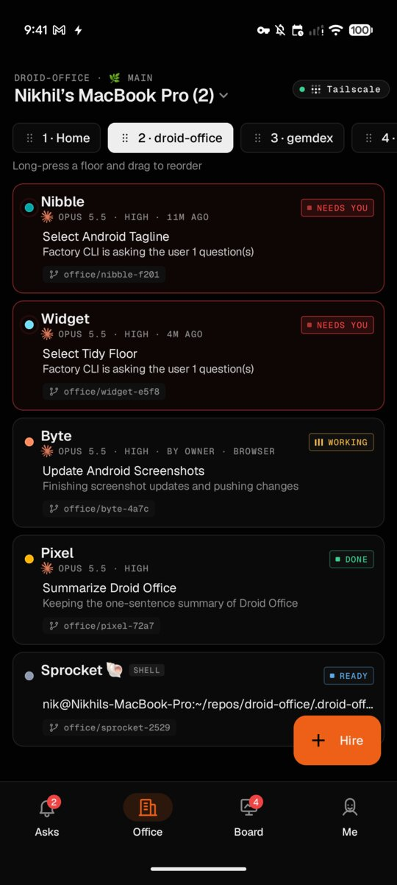
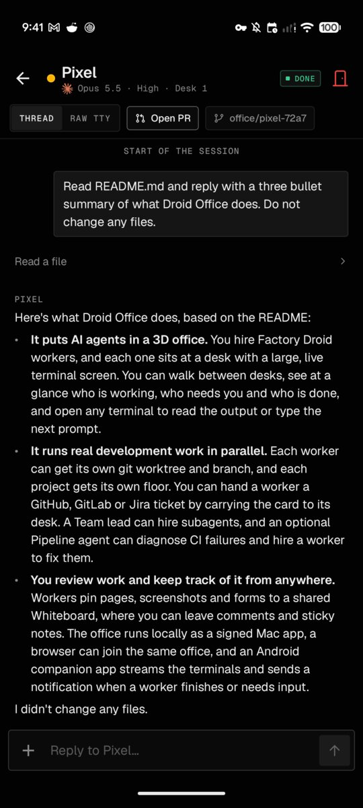
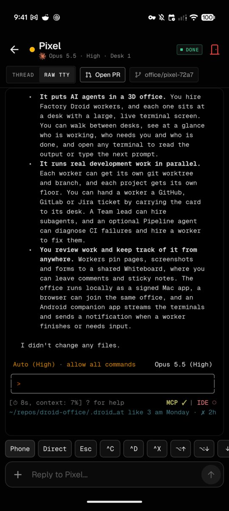
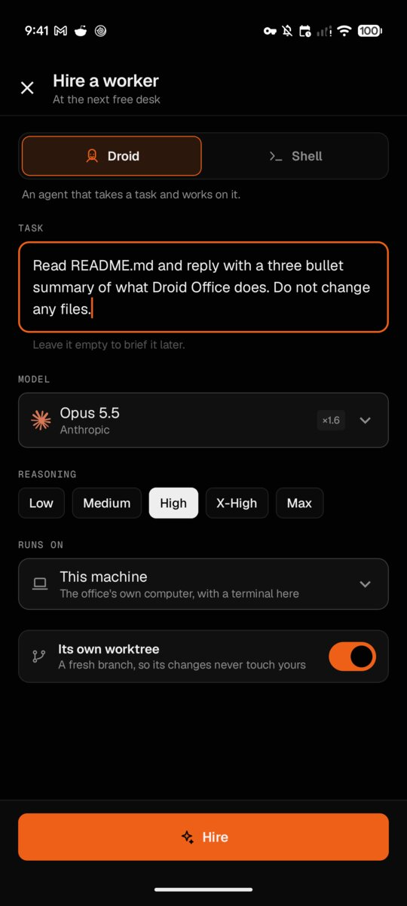
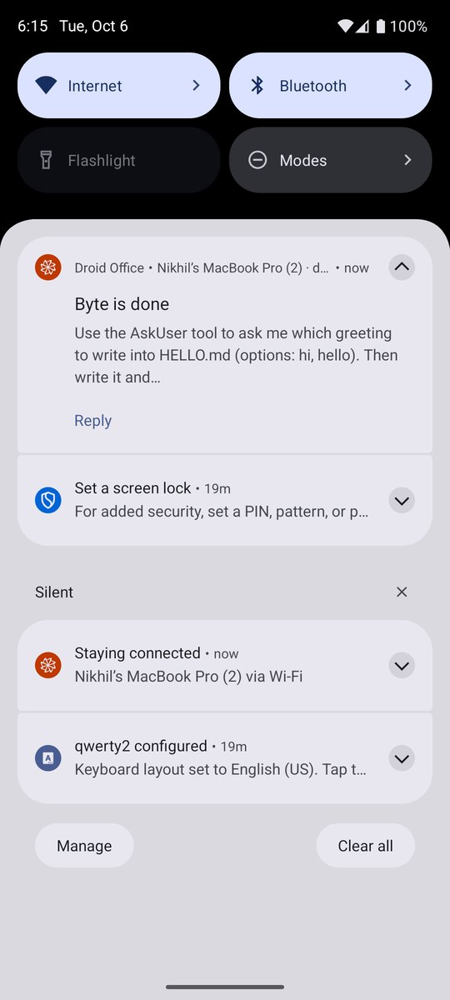
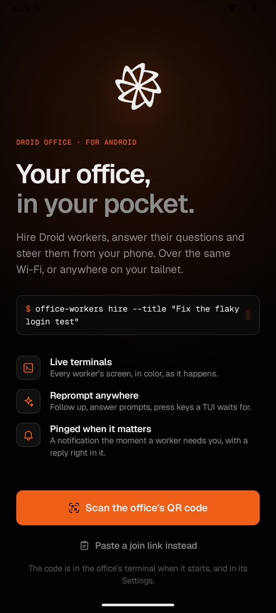
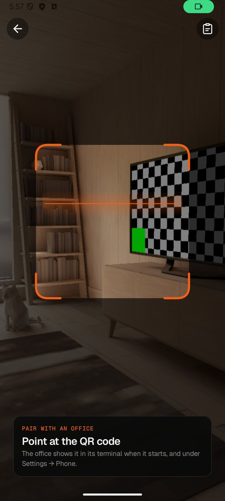
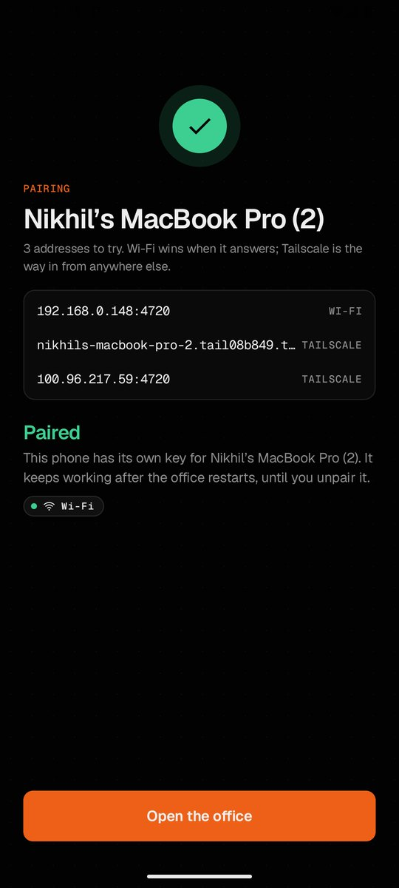
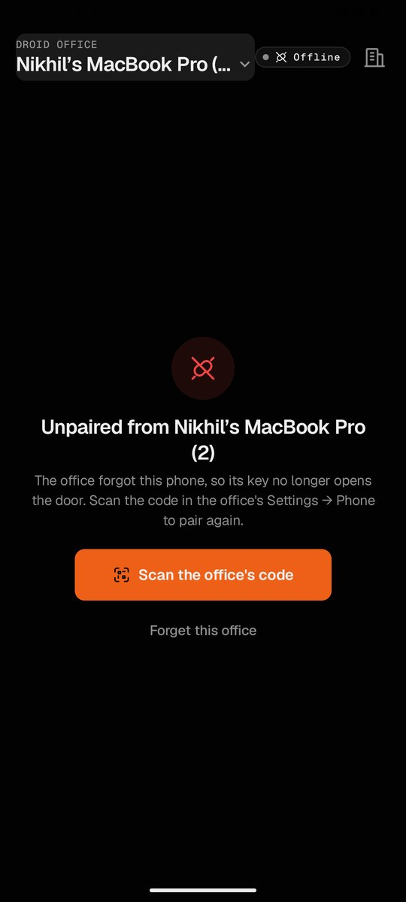

# Droid Office for Android

A companion app for your phone. Pair it with your office once, and from anywhere on your Wi-Fi or your tailnet you can see every worker, hire new ones, watch their live terminals, prompt them, and read and comment on the floor's Whiteboard.

<p>
  
  
  
  
  
</p>

## What it does

AskUser questionnaires on newer Droid CLIs end with **Review your answers**. From Workers or Thread, open **Review answers**, check the selected answers, then tap **Submit answers** to finish. Editing remains available in Raw TTY. Changing an answer or disconnecting invalidates the old review; nothing submits automatically. Older CLIs without this extra step continue to work.

- **Account-free models.** When Airgapped mode is enabled on the host in Settings → Connections → Droid, the phone receives only custom/BYOK models. Hosted remembered picks and arbitrary typed ids are not offered in that mode. Factory cloud choices disappear with the paused Factory connection. This is no-account operation, not a network sandbox.

- **Worker card actions.** Tap a card to open its worker. Long-press it (on either **Workers** or **Office**) for a bottom sheet with only **FORK** and **DISMISS**. Fork explains when a worker is ineligible and confirms an optional new direction; blank leaves the twin ready without starting a turn. Dismiss opens the existing send-home confirmation, defaults to keeping the worktree and branch, and shows the checks before any explicitly chosen deletion. Both actions await the office's floor-scoped receipt and never replay after a disconnect. Back or tapping outside closes the sheet. Working cards show just the animated equalizer, and Done cards a solid green indicator; TalkBack still reads their status, including an unseen completion. Other statuses, questions and errors keep their labels.

- **Mission Control.** The building's agents ([docs/mission-control.md](../docs/mission-control.md)) sit in a pinned section at the top of the Office tab, the same on every floor, and appear alongside every floor's workers in the cross-floor **Workers** tab. The Orchestrator's card shows its status, what it is on, its model and effort, and how many subagents its team has across floors; it is loud when it needs you, like a worker's. Tap it for its Thread and Raw TTY with a composer: your prompt starts or steers it, **Queue** holds one for after its turn, Stop interrupts it, and its questions are answered like a worker's. Its team sits under the header, each worker tagged with its floor; tapping one moves the phone to that floor and opens it. Before its first prompt it says what it is for, with three example prompts that fill the composer; while it can't start (Droid signed out, its model can't run) the reason replaces the composer. The ⋮ menu, and **Me → Orchestrator**, turn it on or off, pick its model and effort (the office's default unless chosen), and start a **New conversation** after a confirmation. External bots (Settings → Phone & web → Tailscale MCP on the office) have a row each with their self-reported status and team, and open to a screen that says they run externally, with their last activity, when their key was last used, and their team. They have no desk, so they never appear in a floor's list. While the Orchestrator is off, its row says so and opens the screen that turns it on. An office from before Mission Control shows none of this, and lists its external bots as workers, which open on the same bot screen.

- **Pair with a QR code.** Open ⚙️ Settings → **Phone & web** in the office on your computer, choose **📱 Pair a phone** and scan the code. The app also takes the join URL's QR code from the office's terminal, a `droidoffice://pair` link, or a pasted link.
- **Deep links from chat.** Office MCP tools and Grok Bot webhooks return clickable `deepLink` URLs (`http(s)://<office-tailscale-or-lan>:<port>/open/worker/<workerId>?floor=<floorId>`, `/open/floor/<floorId>`, `/open/card/<cardId>?floor=<floorId>`, and `/open/question/<workerId>?floor=<floorId>&ask=<questionId>`, with `droidoffice://open/...` as the custom-scheme form) containing zero tokens or private office state. Tapping an `/open/...` URL in a chat app on Android redirects straight into `droidoffice://open/...` via an Android `intent://` URI (falling back to a dark launch card when the app isn't installed or on desktop), matches the right paired office by origin or `?u=`, switches floors when needed, and opens the worker's **Raw TTY** (`?view=thread` opens Thread), the **Office** floor tab, the live **Whiteboard** card, or the pending **AskUser** answer workspace (`answer.workspace`). If the phone isn't paired yet, `screen.welcome` holds the link (`welcome.deep_link`) and navigates there automatically once pairing completes; if the worker, floor, card or question is already gone, the app lands cleanly (`worker.gone`, `board.gone` or an explanatory snackbar).
- **Workers (every floor at once).** The first tab shows every worker across every floor in the building in one live roster, with Mission Control's Orchestrator and bots listed only while they have subagents, with no search or filters (pick a floor in the Office tab). Every card shows its numbered **Floor** and **Repository** (`owner/repo`, `Home` or `Folder`) alongside its model logo, effort dial, todo progress, branch and floor-accurate PR badge; cross-floor subagents nest under their lead. Workers waiting on an answer are pinned at the top under **Needs you**, oldest first, with their floor and repository badges. **Answer questions** opens the full-screen workspace shared with Thread and Raw TTY, even for workers on other floors without switching your active floor. The whole question, options and descriptions scroll without clipping: the text is what the worker's hooks sent the office (`WorkerInfo.ask`), else its open ask call in the Thread, never only what fits on its screen. A permission prompt reads as the call it is about, such as *Approve medium-risk command: git push*. Single-choice rows are radio buttons; checkbox questions say **Select all that apply, then submit**. Tapping a row edits a draft, never sends it. Add a typed answer to checked options if needed, then explicitly **Submit answer**. **Wait before sending** under **Me** keeps a cancellable three-second delay after Submit. Back or Raw TTY keeps the draft. The phone rechecks the screen and session before sending `worker.answer`, then waits for `action.result`; a socket write alone never counts as sent. Changed questions and disconnects block sending. Unconfirmed answers are never replayed, and older offices that cannot accept checkbox answers safely refuse them with Raw TTY as the fallback. Tapping any off-floor worker opens its Thread or live terminal and moves the connection to its floor; long-pressing any desk or cloud worker opens **Fork** and **Dismiss** directly on its floor.
- **Every worker, every floor.** Workers are grouped by floor, the ones that need you first, with what each is doing, its desk and its branch. A Droid working through a todo list shows a bar with how many items are done (3/5) and the one in progress. Pull down to refresh. Subagents sit under their lead. Drag the worker list sideways to slide to the next or previous floor in that numbered order: the floors sit side by side and follow your finger, showing the next floor's workers before you let go, and a flick or a drag past halfway settles on it. It stops at the first and last floor. Tapping a chip slides there the same way. Long-press a numbered floor chip and drag it sideways to reorder floors. Accessibility actions move a floor earlier or later. The order is saved by the office and changes desktop Command+number shortcuts too.
- **Live terminals.** A worker's real PTY streams into a terminal emulator on the phone (xterm.js, the one the office's own terminals use), with the scrollback the office sent, including inline Kitty graphics (`U=1` Unicode placeholders, direct placements and animated frames) rendered on a high-DPI canvas layer; tap any rendered Kitty image to open its first frame in the fullscreen viewer with pinch-to-zoom and double-tap zoom. It has two views. Opening a worker starts in **Phone**, which resizes the actual PTY's columns and rows for readable phone-sized text, so programs wrap and redraw for your screen; opening the keyboard changes only the rows, and rotating the phone fits it again. Tap **Phone** in the quick keys to switch to **Desktop**, which shows the terminal at the size your desktop gave it, scaled to fit the screen, and never changes that size; the size from before goes back, as it does when you leave the terminal. Tap **Phone** again to return to the phone's size. If a desktop window resizes the terminal while you're in Phone, the phone gives way and switches to Desktop. A cloud worker, whose Droid session runs on a Factory computer, has no terminal: it always opens in the **Thread**, with no Raw TTY, quick keys or Direct. Swipe to scroll back through earlier lines, and flick to keep going; **Latest** brings you back to the bottom. In a full-screen program (`less`, `htop`, an editor) a swipe scrolls the program instead: it gets wheel events when it reads the mouse, arrow keys otherwise. Text on the terminal can't be selected. Use Android's screenshot text selection to copy it.
- **Prompt and type.** The composer sends a prompt to a Droid worker, with up to 10 photos attached. While Droid is on a turn, **Send** steers it: Droid reads the message now, the way Enter does in a desktop terminal. **Queue**, beside it only while a turn runs, sends the message the way Ctrl+Enter does, so Droid takes it once the turn is over; messages queued one after another each wait for a turn of their own. Type `/` to pick one of Droid's slash commands from a list: the built-in ones, then the worker's own skills and custom commands (marked **SKILL** and **COMMAND**), as its Droid lists them in the worker's folder. In the Thread, type `@` to mention one of the worker's files or folders, as the web Thread does: a bare `@` lists the top-level folders and root files, more letters narrow it by name and path, picking a folder puts `@folder/` in the draft to keep narrowing, and picking a file puts `@path ` there. Cloud and shell workers have no list. A shell worker gets a single command line. In **Raw TTY**, tap **Direct** beside **Phone** to hide the composer and type straight into the terminal: each letter, Backspace and Enter goes to the live PTY immediately, including edits from a composing keyboard. Tap the terminal to bring its keyboard back, or turn **Direct** off to return to the composer with your draft and pictures untouched. Hardware keyboards work too, including Ctrl and Alt shortcuts and negotiated Kitty `CSI u` progressive keyboard modes. The quick keys under it send Ctrl+C, Ctrl+D, Ctrl+X, Option+Up, Option+Down, the arrows, Enter, Tab, Shift+Tab, Esc, Backspace and `/`, adapting automatically when the terminal program enables Kitty keyboard mode. A shell worker's row has Phone and Direct, then Tab and one-tap commands instead: `git status`, `git fetch`, `git pull`, `git add .`, `git push`, `git diff`, `ls`, `cd ..` and `clear`, each clearing the half-typed line and pressing Enter; that row has no arrange button. On a Droid worker the sliders button at the end of the row opens **Arrange the keys**: drag a key by its handle or move it with its arrows, and **Reset to default** puts the order back. Phone and Direct stay first. The phone keeps the order through app updates, and a key a later release adds appears next to the key it follows by default. A worker opens in **Raw TTY**, the terminal itself with the quick keys, unless you last picked **Thread** on a worker or a connected local Droid worker is waiting on a question with a readable answer menu. Picking Thread is remembered across visits and app restarts until you pick Raw TTY again; workers opened with a draft answer to type always start in Raw TTY. The **Thread** is the worker's conversation as the office presents it: the office reads the worker's Droid session and decides, once for the web companion and the app alike, what the thread shows, groups and says; the app only draws it. Your messages and its replies (Markdown, selectable for copying, with language headers, syntax tinting and **Copy** on fenced code blocks, structured **Email draft** cards with **Copy body**, **Copy all** and **Open in Mail**, and native `<json-render>` widgets) and the notices worth breaking for are top-level. A workspace path the worker names, with or without a line (`src/app.ts`, `src/app.ts:42-51`, `README.md:12`, or a whole inline code span), is a link: tapping it opens the file read-only in a sheet over the Thread, as the office's file preview does, scrolled to that line with it marked, with **Copy path** and **Copy file**. URLs, domains, `@mentions`, absolute and home paths stay text; binary, empty, missing, secret (`.env`) and too-large files say so instead. A cloud or shell worker's paths stay text. Consecutive thoughts and exploration (reads, searches, listings) fold into a compact 1-level Activity disclosure ("Read 4 files · Searched 2 times", with **Working ·** in front while live and not waiting on you) that opens in one tap directly to its flat list of thoughts and tool actions. Edits, shell commands and subagent delegations surface directly in turn order as first-class cards: **File Change** cards show the shortened path, `+N`/`-M` stats and collapsible monospace diff lines with `+`/`-` tinting (expanded by default unless generated, clamping diffs past 80 lines behind **Show full diff**); **Command** cards show `$ <command>`, summary, a copy button and status badge, auto-expanding when a command failed; and **Delegation** cards show the subagent, role, branch and task summary with **Open thread** to jump straight to that worker. An active `TodoWrite` plan surfaces in a sticky collapsible progress bar (`worker.thread.plan`) right above the composer, hiding automatically once a finished plan goes stale after your next prompt. Everything you open or close stays that way through live updates and loading earlier, and resets for a new session. The thread leaves out the agent's bookkeeping (successful TodoWrite, ToolSearch and Skill calls, script wrappers whose calls are listed anyway, plan snapshots and turns that ended normally); anything that failed stays, and a call that never got a result says so instead of looking done. A cancelled or failed turn is a notice of its own. In the Thread view, the Thread and Raw TTY switch shares the row with the PR and branch, and the Send home icon is in the header. A cloud worker's Thread is read from its Factory session by the office; Stop interrupts that session, and a message sent while it is on a turn has no Queue button, since Factory holds it until the turn is over. Slash commands that open one of Droid's dialogs aren't sent to it. While its session or computer is gone, the reason shows above the composer and Send is off. It shows the latest 100 entries, subscribes with `thread.watch` for immediate event-driven pushes while visible and connected (with low-frequency reconciliation as a fallback); **Load earlier** at the top fetches older ones without moving what you are reading, and new messages scroll into view only while you are at the bottom, and opening a disclosure never scrolls it away (a down arrow at the bottom right corner, with a count of the new messages that came in, takes you back). When the session is rewound or rewritten, the entries it dropped leave the thread too. Up to 2,000 entries stay loaded: the oldest go as new ones arrive (Load earlier brings them back), and loading earlier past that lets the newest go until **Back to the latest**. The live activity group shows what is running; Thread omits the duplicate activity footer and raw terminal line. A waiting question has a compact **Answer questions** entry that opens the full-screen answer workspace. While it waits on a question, the composer gives way to a note to answer it first, so a message is never typed into the question; a question the phone can't read says to answer it in Raw TTY. A slash command goes to Droid's input box like a message, so Droid runs it. One that answers with one of Droid's dialogs (`/model`, `/settings`, `/status` and the like, marked **RAW TTY** in the list) is sent and then the app switches to Raw TTY, where Droid shows it; the rest (`/compress`, `/clear`, `/new`, a skill or a custom command) stay in the thread. `/quit` and `/exit` aren't sent, since they would end the worker's Droid (Send home is how a worker leaves), and no slash command is sent while a turn runs, when Droid would take it as steering. An office from before threads, or a session it can't read, says so with **Try again** and **Raw TTY**, and so does a lost connection. An office from before the Thread presentation says **Update Droid Office on your computer to read this Thread here. Raw TTY still works.**, and one whose Thread is newer than the app says **Update the app to read this Thread. Raw TTY still works.**, each with **Raw TTY**. The thread never resizes the shared terminal: the Phone view applies only in Raw TTY. In Raw TTY, when a worker shows a numbered menu (AskUser, a folder-trust prompt), the same compact **Answer questions** entry appears above the terminal; it uses the shared workspace, never a single-choice shortcut for checkbox taps.
- **The Whiteboard.** The **Board** tab is the current floor's [Whiteboard](../docs/whiteboard.md): every card newest first, as the office renders it, with its format badge (**MD**, **VIDEO**, **IMG**, **HTML**, **CANVAS**), who made it, when it changed, its open comments, and an orange mark on each card someone else changed since you looked (the tab's badge counts them). Search cards by title, author, comment or note, and filter with **All**, **Changed**, **Open comments**, **Markdown**, **Video**, **HTML**, **Images** and **Canvas** chips. Pull down to fetch it again. Tap a card to open it live, as the office's window shows it, with previous and next arrows in the header when the board has more than one card: the card runs in the same sandboxed frame, so its videos play, its forms, buttons and links work, and what it records reaches the board (a recorded action says so, with **Ping a worker** to tell one now; a card's `data-wb-ping` button tells the worker who made the page by itself, and the snackbar says who it went to, while it's disabled when that worker isn't on the floor). Pinch to zoom. **Use** is for the card itself; in **Mark up** a tap pins a comment there and a long-press places a sticky note, while a drag scrolls the card. Tap a sticky to write on it, change its colour, move it to another spot or delete it, and drag it or its corner to move or resize it; the picture button adds a photo from your phone at the middle of the view. Pins, stickies and pictures sit where the office puts them, following the element they're attached to. **Comments** lists the card's threads, open ones first, where you reply, edit your own comments, resolve and reopen, **Show** one on the card, **Move** it to another spot, or tap a `@mm:ss` / `@12.5s` timestamp on a live video card to jump the video there; it lists the sticky notes too. Threads and notes changed since you last looked are marked New, with an orange ring on the card. The full-screen button hides everything but the card, and a card video's own full-screen button fills the phone with the video until you press Back or leave it from the video's controls. Rotating the phone keeps the card, and a playing video, where it was. A card that can't load because the office is out of reach says so, with **Try again**. Opening a card marks it read, as the office's own panel does. The wall icon puts the card on the office's wall (or the grid back), and **Ping a worker** asks one of the floor's workers to read the board, as its status allows: the sheet says why one can't take it now. On a phone whose WebView is too old for the live card, or an office from before card capabilities, the card shows as the office renders it instead: pinch or double-tap to zoom, and long-press the page to pin a comment. The grid's thumbnails are always the office's renders (it downloads its Chromium on first use, and the tab says why when it can't render), and the board can't change while the office is unreachable.
- **Hire from your phone.** Hiring opens a full screen with its own close button, so scrolling it never drags it away, and a task you typed is still there if you close it without hiring. Tap **Shell** to open a plain shell at once, with no prompt or worktree, as **B** at an empty desk does in the office; it opens straight to its terminal. For a Droid, pick a first prompt, a model and reasoning effort, and whether it gets its own git worktree on a project floor. Home and plain folders do not show the worktree switch. With its own worktree, **Also work in** lists the building's other git floors: each one picked gets a worktree of its own on the same branch, with a pull request of its own, as in the office's hire dialog; picking one turns the worktree on, and turning the worktree off clears them. The model list opens full screen too. Search it by name, provider or id, ignoring punctuation; matching words light up. Filter with All, Yours, provider and Legacy chips. Your models group by gateway, Factory's by provider, with your four recent picks first. Rows show the model family's own LobeHub logo, Factory credit multipliers and capability/promotion labels. An id not in the list can be used as typed. The sheet starts on the model and effort you hired with last. A model of your Claude, ChatGPT or other plan that can't run now (out of quota, no account connected, its provider switched off, DroidProxy not installed) is dimmed with the reason and can't be chosen; a stopped DroidProxy only adds a quiet note, since the office starts it. The office seats it at the first free desk, then the first free bean bag. When the office is connected to Factory and has an Environment a computer can start from, or an active computer, the **Runs on** dropdown offers this machine, a fresh computer from an Environment (the default one first) or one of your computers, with a **Folder** there and what leaving it empty means; that Droid gets no worktree, and your own (BYOK) models are dimmed for it, since they can't run on a Factory computer.
- **Subscriptions.** **Me → Subscriptions** shows the paired office's DroidProxy status, provider accounts, usage left and reset times, and whether its model list needs updating. Logos identify each plan. This view is read-only; manage sign-ins, accounts and installation in **Settings → Connections** on the office's Mac. An older office without subscription status says so.
- **Run the floor.** Resume a sleeping worker, ask a worker on a branch to open its pull request (or open the one it has), or send it home (keeping or deleting its worktree and branch, or a cloud worker's Factory session).
- **Notifications with replies.** When a worker or the Orchestrator needs you or finishes, the phone notifies you (a subagent finishing doesn't: its lead reads that), and quietly updates the notification when the office fills in what it's asking. When the phone can read the question on the worker's screen, the notification shows it with its choices and has buttons for the first two; **Reply** takes a choice's number or your own answer. Either is checked against the worker's screen first, like an answer from Asks, and the notification then says whether it went. Checkbox questions have no one-tap or typed notification actions: open the app to edit the selection and submit explicitly. Otherwise a reply goes straight to that worker as a prompt. The app asks for notification permission once, right after pairing; after that, **Allow** under **Me** opens the system prompt or, once Android stops showing it, the app's notification settings. Turn on **Stay connected** to keep the connection open while the app is in the background; otherwise notifications only arrive while the app is open or shortly after.
- **More than one office.** Pair a laptop and a server and switch between them under **Me**. **Rename** on an office is only on this phone: the office keeps its own name, and the one you chose stays through app updates and reconnects. Leave it blank to show the office's name again.
- **Update from the app.** A quiet check when you open it tells you when a newer Android app is available. Under **Me → About**, tap **Update app**, then **Update now** to download it with progress and open Android's installer. The welcome screen has the same control before pairing. Downloads start only when you ask, can be cancelled, and keep going if you tap **Keep using app**.
- **Update the host Mac.** **Me → About → Host desktop app** checks the Mac app that runs the active office. Confirm **Install and restart** to download its signed update, follow progress, and restart the host while workers keep running. The phone reconnects automatically. Closing the sheet does not cancel the host update. Checkout hosts and older offices explain why remote updates are unavailable; update an older office on its Mac first.
- **Tablets and foldables.** Office shows the worker list on every screen. On wide screens the list and selected worker sit side by side, with the tabs in a rail.

Typing just `/` offers the complete slash-command list. Swipe through the bounded menu to reach every built-in command, skill and custom command without typing more characters.

<p>
  
  
  
  
</p>

## Install it

You need Android 9 or newer and an office new enough to pair phones (one whose ⚙️ Settings has a **Phone** category).

1. Download `Droid-Office-<version>.apk` from the [latest release](https://github.com/nikships/droid-office/releases/latest) on your phone.
2. Open it and allow your browser or file manager to install apps when Android asks.
3. Open **Droid Office**, tap **Scan the office's QR code**, and scan the code from ⚙️ Settings → **Phone & web** on your computer.

The APK keeps its original version when a Mac-only release carries it forward unchanged. The app offers an update only when a newer Android APK is available. Installing it over the old keeps your paired offices.

### Update it

The app checks the public [latest GitHub release](https://github.com/nikships/droid-office/releases/latest), independently of the office you're paired with. It checks when it comes to the foreground, at most once an hour in a running app (15 minutes after a failed check). **Check for updates** under **Offices → About**, or on the welcome screen, checks immediately.

When an update is available, tap **Update app → Update now**. It downloads and verifies the APK, then opens Android's installer. The first time, Android asks you to allow installs from **Droid Office**; enable **Allow from this source** and return to the app to continue. Confirm the update in Android and reopen Droid Office. Your offices, keys and settings stay put. This is not an unattended background update.

Cancel the installer and **Install update** tries again without downloading again. A finished download can also be reused after the app restarts, after its size, checksum and package are checked again. A download interrupted by process death restarts on the next **Update now** tap. If the phone is offline, GitHub is rate limited, the APK isn't ready, or in-app installation isn't possible, **Download newest version** opens the latest release in your browser. Debug builds offer that link instead of trying to replace themselves with the differently named release app.

The updater uses only HTTPS, no GitHub login or office token. Before installation it checks GitHub's SHA-256 digest, the package name, version code, Android requirement and the installed app's signing key. The APK is kept in private cache and shared read-only with the installer; no storage permission is needed. See [the update design and research](docs/updates.md) for the alternatives and platform limits.

## How it connects

- **Wi-Fi first, then Tailscale.** The pairing code lists the office's Wi-Fi addresses, then its Tailscale MagicDNS name and `100.x.y.z` address. Each time it connects, the app asks every address at once and uses the first that answers, but waits a moment (600 ms) for a Wi-Fi address still in flight before settling for Tailscale. It races again whenever the phone's network changes, so walking out of the house moves it to Tailscale on its own. While it is on Tailscale it asks the Wi-Fi addresses again every 30 seconds, and moves back as soon as one answers (after a Wi-Fi blip nothing about the phone's network changes). For Tailscale, sign the phone in to the same tailnet as the office's machine.
- **Device token.** Pairing trades the office's one-time LAN token for a device token of its own (`POST /api/mobile/pair`), so the phone stays paired when the office restarts. Pairing an office the phone is already paired with replaces the old entry and hands the office back the old token, so the office lists the phone once. Pairing runs in the app's scope, so rotating the phone mid-way doesn't pair twice. The app sends it as `Authorization: Bearer` on every request and on the WebSocket. Against an office from before phone pairing, the app falls back to the LAN token in the link, which stops working when that office restarts.
- **Forgetting a phone.** **Forget** next to the phone in the office's Phone window, or **Forget** next to the office under **Offices** in the app, unpairs it. When the office refuses its token (a `401`, or the WebSocket closing with `4401`), the app stops reconnecting and shows **Pair again**.
- **Reconnects.** A dropped connection retries after 1 s, 2 s, 4 s … up to 30 s. The app keeps its connection while it is on screen, while **Stay connected** is on, or while it sends a notification reply, and closes it 20 seconds after the last of those ends.

## Security

- The device token is as good as a shell on the office's machine. The app keeps it encrypted with an AES-256-GCM key in the Android Keystore (hardware backed where the phone has it), and turns off Android's cloud and device-to-device backups, so a new phone pairs again.
- An office serves plain HTTP on its LAN and tailnet addresses, so the app allows cleartext, but only to private addresses: loopback, link-local, RFC 1918, Tailscale's `100.64.0.0/10` and IPv6 unique-local. `net/CleartextGuard.kt` checks the address each connection actually reached, before any of the request is sent. An office on a public address needs HTTPS. Only the system's certificate authorities are trusted.
- Native model logos are bundled in the APK, with LobeHub’s MIT attribution: 128px PNGs rendered from the same official colored SVGs, including their gradients and masks. Only marks with no colored variant are tinted for contrast.
- The terminal is a WebView showing a page bundled in the app (`assets/terminal/`), served by `WebViewAssetLoader`. Every other request it makes is answered with a 404, it can't navigate away, and it has no file or content access. Terminal output reaches it through the app, never from the network. The page sends the app only touch scrolls; direct typing uses a native Android input connection, so xterm's terminal-query replies are never forwarded to the PTY.

## Build it

You need JDK 17 or newer (CI uses 21) and the Android SDK with platform 37. Android Studio provides both; on the command line, point `ANDROID_HOME` at the SDK or write `sdk.dir=<path>` to `android/local.properties`.

Run from `android/`:

| Task | Command |
| --- | --- |
| Unit tests | `./gradlew testDebugUnitTest` |
| Lint (any error fails) | `./gradlew lintDebug` |
| Debug APK (`ai.factory.droidoffice.debug`, installs next to a release build) | `./gradlew assembleDebug` |
| Install the debug APK on a connected phone or emulator | `./gradlew installDebug` |
| Release APK, minified with R8 | `./gradlew assembleRelease` |

The release APK is signed with the keystore in `ANDROID_KEYSTORE_FILE`, `ANDROID_KEYSTORE_PASSWORD`, `ANDROID_KEY_ALIAS` and `ANDROID_KEY_PASSWORD` when they are set, and otherwise with the machine's debug key (`~/.android/debug.keystore`, which the Android build creates the first time it needs one). A debug-signed APK installs, but Android only updates an app with an APK signed by the same key. `-PofficeVersion=0.1.123 -PofficeVersionCode=123` sets its version.

After changing the web's model-logo mapping or SVGs, run `node --import tsx tools/android-model-icons.mjs` from the repository root (with the office's Chromium installed) and commit the generated PNGs and manifest. Android's own build needs neither Node nor an SVG decoder.

To try it against a local office from an emulator, start the office (`node bin/droid-office.js <project>`), open ⚙️ Settings → **Phone & web**, and pass the link to the emulator; `10.0.2.2` is the host machine:

```bash
adb shell "am start -a android.intent.action.VIEW -d 'droidoffice://pair?v=1&name=My%20Mac&t=<token>&u=http://10.0.2.2:4600'"
```

## Drive it with adb

The shared answer workspace is `answer.workspace`. Its scrollable content is `answer.content`, with the complete `answer.question` and `answer.instruction`. `answer.review` holds the final questionnaire's question/answer summary. `answer.option/<n>` is a checked checkbox or selected radio row, `answer.type` enables a typed answer and `answer.text` edits it. `answer.submit` explicitly submits, `answer.cancel` cancels the optional delay, `answer.status` explains sending, stale, disconnected or unconfirmed state, `answer.close` returns with the draft kept, and `answer.raw_tty` opens the terminal. `answer.open` is the compact entry on all three surfaces.

In Thread, the list follows the newest entry and stays at the bottom through new entries, a queued turn, the question card and font, density or window changes. Scrolling up stops following until you scroll back to the bottom. Opening an Activity, a run, a call's details, a thought, or a long message brings what opened into view and stops following until you ask: the down arrow (`worker.thread.jump`) floats over the conversation's bottom right corner only when there is content below the viewport, with the new-message count on it, and tapping it, or sending a message, follows again. At the bottom it stays hidden, even with details open and following paused. Opening the keyboard shrinks the list without stopping it following, and the bottom bar gives way to the keyboard so the composer sits right on it. On a tablet or a wide window the conversation and the composer keep to a reading width in the middle, and your messages keep their line breaks. What is open, whether it follows and where you were reading survive a font, density or theme change recreating the screen. Wide code and Markdown tables (`worker.thread.table`, columns lined up, scrolling sideways as one) show a short fade and a chevron at the right edge while there is more to the right (`worker.thread.code.hint`, content-desc "Scrolls sideways"). The answer workspace enriches shortened terminal text from the pending AskUser call, matching options by their numbers and prefixes. It keeps earlier question paragraphs and complete long options, and never guesses between ambiguous questions. The original screen menu remains authoritative for sending; the CLI's generic asking notice never stands in for a question. While a turn runs, `composer.stop` stops it with Esc, the same key as Raw TTY's `key.escape`, which is now first in the quick keys by default. With the keyboard open the composer shows three lines and scrolls the rest of the draft. Offline, Send and Queue are off, the draft stays, and nothing is sent later on its own: the one notice under the header (`worker.offline`) says the screen or thread is the last the office sent, with `composer.offline` saying Send is off, and the status pill is hidden until the phone reaches the office again. The worker's model, effort and desk under its name wrap onto a second line between parts rather than being cut off, and no line starts or ends with a separator dot. Table cells break only between words, never inside inline code: a cell is as wide as its longest command, and the table scrolls sideways. Raw TTY lifts text too dark to read against its background (minimum contrast 4.5:1), such as the key names in Droid's queue hint. Both views share one band under the header: the Thread and Raw TTY switch, then the PR and branch; The Send home icon is in the header.

While a turn runs, what waits in Droid's queue shows after the conversation (`worker.thread.queued`): a **Queued · 2** line, then each message as a hollow bubble on your side (`worker.thread.queued/<n>`, from 1), oldest first, and **Sent once this turn is over.** The list is the one Droid shows above its input box, read off the worker's screen, so a message queued from the desktop or the web shows too. Droid shows each message as one line, maybe cut short: one this phone sent shows its whole text, and another client's says **Shortened** or how many more lines it has. A message just queued shows at once, before Droid draws it, and goes once Droid's queue no longer has it and the conversation shows it. While the screen can't be read (a dialog is open, or there is no screen yet), the messages this phone queued show instead. **Clear queue** (`worker.thread.queued.clear`), there while Droid's screen shows a queue, sends Ctrl+X, Droid's own key for clearing it. Messages queued from the phone are kept through switching views, rotation, a restart or a force-stop, in a file per worker (not backed up; at most 12 workers, least recently written dropped first, each up to 32 messages), until the conversation shows them, Droid's queue no longer has them, a new session starts or the office is forgotten. Owner-cancelled tool execution is **Cancelled**, not a red failure; the underlying error remains in its details.

Every screen and control has a stable name from [`core/Tags.kt`](app/src/main/java/ai/factory/droidoffice/core/Tags.kt), which `uiautomator dump` prints as the node's `resource-id`. An agent can see where the app is and tap a control by name instead of by its text or position:

```bash
# What's on screen: each tagged node with its text and bounds.
adb exec-out uiautomator dump /dev/tty | sed 's/<node /\n<node /g' | grep 'resource-id="[^"]'

# Tap a control: take the centre of its bounds="[l,t][r,b]".
adb shell input tap 672 2577
```

- **Where you are.** The screen's root is one of `screen.welcome`, `screen.scan`, `screen.pair`, `screen.home`, `screen.worker` or `screen.offices`, and once paired the tabs `screen.workers` (Workers), `screen.home` (Office), `screen.board` and `screen.me`, switched with `tab.workers`, `tab.office`, `tab.board` and `tab.me` in `tab.bar` (the Workers tab's badge has the content-desc "2 waiting" across all floors, the Board tab's "3 changed"; `screen.asks` and `tab.asks` remain reserved). An open Whiteboard card is `screen.board_card`. A sheet or dialog adds its own root: `hire.sheet` (the hire screen), `hire.model_sheet` (its model list), `paste.sheet`, `send_home.dialog`, `forget.dialog`, `offices.rename_dialog`, `board.comments_sheet`, `board.sticky_sheet` or `board.ping_sheet`.
- **Dynamic names.** A name with an id in it has the id after a `/`: `workers.card/<workerId>`, `workers.ask/<workerId>`, `home.worker/<workerId>`, `home.floor/<floorId>`, `home.floor_more/<floorId>`, `hire.model/<modelId>`, `hire.model_why/<modelId>`, `hire.repo/<floorId>`, `hire.effort/<effort>`, `worker.choice/<number>`, `composer.slash/<name>`, `composer.mention/<path>`, `worker.thread.file_preview.line/<n>`, `worker.thread.queued/<n>`, `worker.thread.entry/<entryId>`, `worker.thread.toggle/<entryId>`, `worker.thread.change/<changeId>`, `worker.thread.change.full/<changeId>`, `worker.thread.command.copy/<entryId>`, `worker.thread.delegate.open/<entryId>`, `worker.thread.change.preview/<changeId>`, `worker.thread.cards/<firstCardEntryId>` (and `.toggle`), `worker.thread.turn.changes/<rowId>`, `worker.thread.turn.file/<rowId>/<n>`, `worker.thread.group/<firstEntryId>` (and `.toggle`, `.summary`, `.status`, `.running`, `.error`, `.plan`), `worker.thread.run/<firstEntryId>` (and `.toggle`, `.plan`), `worker.thread.not_loaded/<entryId>`, `worker.thread.image/<imageId>`, `send_home.option/all|worktree|keep`, `offices.office/<officeId>`, `offices.name/<officeId>`, `offices.rename/<officeId>`, `offices.forget/<officeId>`, `composer.remove_image/<n>`, `board.card/<cardId>`, `board.thread/<threadId>`, `board.thread.reply/<threadId>`, `board.thread.reply_send/<threadId>`, `board.thread.resolve/<threadId>`, `board.thread.show/<threadId>`, `board.thread.move/<threadId>`, `board.sticky/<stickyId>`, `board.sticky.color/<color>`, `board.ping/<workerId>`, `board.ping.author/<workerId>` and `worker.keys_sheet.key|up|down/<keyId>`.
- **Workers.** The cross-floor list is `workers.list`, with `workers.summary` and `workers.waiting_count` in the header, Pinned questions sit under `workers.needs_you`: the focused `workers.ask/<id>` holds `asks.card` (`asks.card.worker`, `asks.card.context`, `asks.card.question`, `answer.open`, `asks.card.open_thread` and `asks.card.waiting`), queued questions are `workers.ask/<id>`, and recent server-confirmed answers are `workers.answered`. Each roster card is `workers.card/<id>`, with `workers.card.name`, `workers.card.status`, `workers.card.floor`, `workers.card.repo`, `workers.card.meta`, `workers.card.title`, `workers.card.detail` and `workers.card.todos`. The empty state is `workers.empty` (`workers.empty.hire`), with `workers.hire` for the round **+** button (TalkBack reads it as "Hire") and `workers.pick_worker` on wide screens. The former `asks.*` identifiers stay reserved.
- **Home.** Each worker card is `home.worker/<id>`. Inside it are `home.worker.name`, `home.worker.status` (its content-desc is the status: "Needs you", "Working", "Ready", "Done", "Asleep"), `home.worker.meta` (its text is the model, its effort in words such as "High effort", and the rest of the line, though the card draws the effort as a dial), `home.worker.title`, `home.worker.detail` and, while it has a todo list, `home.worker.todos` (its content-desc is "Todo list 3/5 · " and the item in progress, or "Todo list 3/5 done"). The other names on this screen are `home.hire` (the round **+** button, which TalkBack reads as "Hire"), `home.hire_first` (on an empty floor), `home.pager` (the floors side by side; drag it sideways to change floors), `home.floor_page/<id>` (each floor's page; the one the phone is on is the only one while nothing is sliding), `home.list` (swipe it to scroll), `home.loading`, `home.route` (content-desc "Connected over Wi-Fi" and so on), `home.connection`, `home.retry`, `home.pair_again` and `home.offices`.
- **Mission Control.** The section is `mission.section`, collapsed and expanded by its heading `mission.toggle` (state description `Expanded` or `Collapsed`). The Orchestrator's card is `mission.orchestrator`, with `mission.orchestrator.status` (content-desc is the status), `mission.orchestrator.meta`, `mission.orchestrator.detail` and `mission.orchestrator.blocked`; while it is off its row is `mission.orchestrator_off`; each bot is `mission.bot/<botId>`. The Orchestrator opens on `screen.worker` with the worker id `orchestrator`: before its first prompt `orchestrator.intro` with `orchestrator.example/<n>` (from 1), while it is off `orchestrator.off` with `orchestrator.turn_on`, and `orchestrator.blocked` in place of the composer while it can't start (no session, or one asleep; a running session keeps its status, composer and Stop even when the office can't start a new one). Its team is `orchestrator.team`, each worker `orchestrator.team/<workerId>`, shown with or without a session (after **New conversation** it sits above the intro). `orchestrator.menu` (also under Me as `settings.orchestrator`) opens `orchestrator.sheet`, with `orchestrator.on` (`checked` is on), `hire.model` for its model, `orchestrator.model_default`, `orchestrator.effort/<effort>` or `orchestrator.effort/default` (`checked` is chosen), and `orchestrator.new_conversation`, which asks in `orchestrator.new_dialog` with `orchestrator.new_confirm` and `orchestrator.new_cancel`. A bot opens on `screen.bot`, with `bot.name`, `bot.status`, `bot.activity`, `bot.last_used` and `bot.team`, its workers `orchestrator.team/<workerId>`. `worker.remote` stays reserved but is not rendered.
- **Floor chips.** The row never scrolls or cuts a name short. The current floor always has its `home.floor/<id>` chip (its name shortens only when the row is narrower than that chip beside "+N more"); the others get one most relevant first (workers waiting, then working, then any workers, then recent visits and hires, as on the web) until the next would not fit. The rest sit under `home.floor_more` ("+N more", its badge the workers waiting there), which opens `home.floor_more.menu` with a `home.floor_more/<id>` row per floor, most relevant first. Long-press and drag a chip horizontally to change its number; dropping past the last chip places it after that floor, and dropping it back between the chips it started between leaves the order alone. `home.floor_order_hint` names the instruction below the chips.
- **Worker card actions.** Long-press `home.worker/<id>` (TalkBack: **Worker actions**) to open `worker_actions.sheet`. `worker_actions.name` identifies the clicked worker. Its only actions are `worker_actions.fork` and `worker_actions.dismiss`; `worker_actions.fork_reason` explains a disabled Fork. Fork opens `fork.dialog`, with `fork.prompt`, `fork.confirm`, `fork.cancel` and `fork.error`. Dismiss opens `send_home.dialog`, with `send_home.confirm`, `send_home.cancel`, `send_home.option/all|worktree|keep` and `send_home.error`. Back/outside cancels the sheet without opening the worker or sending anything.
- **A worker.** `worker.terminal` has the whole terminal screen as its `text` attribute, so a dump reads it without a screenshot. `worker.status`, `worker.name` and `worker.meta` describe the worker. `worker.view.thread` and `worker.view.tty` switch the view (`selected` is the one showing). The thread is `worker.thread`: its conversation is the lazy list `worker.thread.list` (swipe it to scroll), each message or notice `worker.thread.entry/<entryId>`. Fenced code blocks carry `worker.thread.code.copy`, `email` draft cards carry `worker.thread.email` (`worker.thread.email.copy_body`, `worker.thread.email.copy_all`, `worker.thread.email.open`), and `<json-render>` widgets carry `worker.thread.widget`. A message from the owner longer than eight lines shows its start, with `worker.thread.more/<entryId>` to show all of it (`checked` is all of it) and show less again. Each Activity turn container is `worker.thread.group/<firstEntryId>` (the id of its first entry, shown or not): consecutive exploration blocks inside it open in one tap via `worker.thread.group.toggle/<firstEntryId>` (`checked` is open), with summary `worker.thread.group.summary/<firstEntryId>`, status `worker.thread.group.status/<firstEntryId>` and live action `worker.thread.group.running/<firstEntryId>`, revealing flat `worker.thread.entry/<entryId>` thoughts and tool actions (`worker.thread.toggle/<entryId>` opens details; `worker.thread.run.plan/<firstEntryId>` shows a changed plan; `worker.thread.group.error`, `worker.thread.run` and `worker.thread.run.toggle` remain reserved). Top-level cards render directly in turn flow: a File Change card is `worker.thread.change/<changeId>` inside `worker.thread.entry/<entryId>` (`worker.thread.toggle/<changeId>` expands/collapses its diff, `checked` when open, `worker.thread.change.full/<changeId>` toggles clamping past 80 lines, and its path, `worker.thread.change.open/<changeId>`, opens the file in the preview at its first changed line, or at the top when the office couldn't number the diff; a Markdown, HTML or picture file the worker created also has `worker.thread.change.preview/<changeId>`; diffs start open only in the latest turn, at most three small ones); a Command card is `worker.thread.entry/<entryId>` (`worker.thread.toggle/<entryId>` opens output, `worker.thread.command.copy/<entryId>` copies the command, its line highlighted as shell); and a Delegation card is `worker.thread.entry/<entryId>` (`worker.thread.toggle/<entryId>` opens details, `worker.thread.delegate.open/<entryId>` opens the subagent's thread). Three or more cards in one Activity fold under `worker.thread.cards/<firstCardEntryId>`, opened and closed with `worker.thread.cards.toggle/<firstCardEntryId>` (`checked` is open; open in the latest turn), which also counts the files they changed. A finished turn that changed files ends with `worker.thread.turn.changes/<rowId>` under its last message or Activity, each file `worker.thread.turn.file/<rowId>/<n>` (from 0) opening the file preview. `worker.thread.not_loaded/<entryId>` shows inside an open call while its entry isn't loaded. A file opened from a path link is `worker.thread.file_preview`, with `worker.thread.file_preview.path`, `.copy_path`, `.copy_file`, `.status` (loading, an error, a binary or empty file, or the truncation notice), `.meta` (its line count and size) and `.lines`, each line `worker.thread.file_preview.line/<n>` (`selected` is the line the link named); Back or a swipe down closes it. Above the composer, an active TodoWrite plan renders `worker.thread.plan`, expanded and collapsed with `worker.thread.plan.toggle` (`checked` is open). A picture in a call's result or in a message is `worker.thread.image/<imageId>` (content-desc names it); tapping it, or tapping a Kitty image in Raw TTY, opens `worker.thread.image_viewer` (pinch or double-tap to zoom), closed with `worker.thread.image_viewer.close`, a tap on the unzoomed picture or Back. `worker.thread.group.plan/<firstEntryId>` and `worker.cloud` (the old cloud placeholder) remain reserved but are not rendered. In both views of a Droid worker the switch, PR and branch share `worker.thread.bar`. At the top are `worker.thread.earlier` (load older entries) or `worker.thread.start`, and `worker.thread.error` when the office couldn't update it. With nothing to show, `worker.thread.state` says whether it is loading, empty, unavailable or disconnected, or, inside `worker.thread.update`, that the office or the app needs updating to read the Thread, with `worker.thread.retry` and `worker.thread.raw_tty`; `worker.thread.prompt` is then what it was asked. `worker.thread.jump` returns to the newest message (`worker.thread.jump.label`, its arrow, has the content-desc "Jump to latest" or how many new messages are below; hidden when already at the bottom), and `worker.thread.newer` reloads the newest page after older ones pushed it out. The question's compact `asks.card` opens `answer.workspace`, with `worker.thread.raw_tty` when the phone can't read it. The former `worker.thread.activity` and `worker.live_line` identifiers remain reserved but are not rendered in Thread. `worker.thread.waiting` replaces the composer while it waits on a question, with `worker.thread.waiting.raw_tty` to answer it there. In Raw TTY, `worker.needs_you` and `worker.question` show what it is waiting on, and `answer.open` opens a numbered menu in the shared answer workspace (`worker.choice/<n>` remains reserved). Type with `composer.input` (tap it, then `adb shell input text`) and send with `composer.send`, While a Droid worker is on a turn, `composer.send` steers the turn and `composer.queue_send` sends to Droid's queue instead. Typing `/` opens `composer.slash_menu`, each command in it `composer.slash/<name>`. Typing `@` in the Thread opens `composer.mention_menu`, each file or folder in it `composer.mention/<path>` (folders end in `/`). The former `composer.queue`, `worker.thread.queued.summary`, `worker.thread.queued.toggle`, `worker.thread.queued.raw_tty`, `worker.thread.queued.dismiss` and `worker.thread.queued.unsaved` identifiers remain reserved but are not rendered. In the Thread view `composer.stop` stops a running turn, and `composer.offline`, inside `worker.offline`, explains a disabled Send while offline. `worker.input.direct` is `checked` when Direct mode is on: the composer is hidden and typing goes straight to the terminal. The quick keys are `key.` plus what TalkBack says, with spaces turned into underscores: `key.escape`, `key.control_c`, `key.control_d`, `key.control_x`, `key.option_up`, `key.option_down`, `key.down`, `key.up`, `key.left`, `key.right`, `key.enter`, `key.tab`, `key.shift_tab`, `key.backspace` and `key.slash`. A shell worker's row is `key.tab`, `key.git_status`, `key.git_fetch`, `key.git_pull`, `key.git_add_.`, `key.git_push`, `key.git_diff`, `key.ls`, `key.cd_..` and `key.clear`. `key.phone` is `checked` when the Phone view is on and the phone sizes the terminal. `worker.keys.arrange`, at the end of the row, opens `worker.keys_sheet`, where each key is `worker.keys_sheet.key/<id>` with `worker.keys_sheet.up/<id>` and `worker.keys_sheet.down/<id>` (the id is the `key.` name without `key.`: `control_c`), plus `worker.keys_sheet.reset` and `worker.keys_sheet.done`. Also here: `worker.back`, `worker.resume`, `worker.pr`, `worker.branch`, `worker.send_home` (the header icon for all workers), `worker.latest`, `worker.asleep`, `worker.asleep.resume`, `worker.cloud.error` (why a cloud worker can't work right now; Send is off), `worker.offline`, `worker.gone` and `composer.attach`.
- **The Whiteboard.** The grid is `board.grid` (swipe it to scroll), with `board.search`, `board.filter/<id>` (`all`, `changed`, `comments`, `markdown`, `video`, `html`, `image`, `canvas`; `selected` is the one on) and `board.no_match` when nothing matches; each card is `board.card/<id>` with `board.card.format` (**MD**, **VIDEO**, **IMG**, **HTML**, **CANVAS**), `board.card.title`, `board.card.meta` and `board.card.changed` (content-desc "Changed since you looked"); `board.loading`, `board.empty` and `board.renderer` (why cards can't be rendered yet) are its other states, and `board.ping` opens the ping sheet. An open card has `board.back`, `board.title`, `board.meta` (who, when, its link and "On the wall"), `board.prev` and `board.next` (when the board has more than one card), `board.show`, `board.fullscreen` (also the button that leaves full screen), `board.video_fullscreen` (what the card itself put in full screen, such as its video; Back leaves it), `board.ping`, `board.comments`, and `board.gone` once it's deleted. A live card is `board.live`, a WebView whose content a dump doesn't show; under it are `board.hint`, `board.mode.use` and `board.mode.markup` (`selected` is the mode on) and `board.add_picture`. A card shown as rendered is `board.image` (long-press it to comment) with `board.image.status` ("Rendering…" and so on). A new comment is `board.new_comment` with `board.comment.input`, `board.comment.send` and `board.comment.cancel`. In `board.comments_sheet` each thread is `board.thread/<id>` with its reply field, send and resolve buttons, `board.message.edit/<messageId>` (opening `board.message.input/<messageId>`, `board.message.save/<messageId>` and `board.message.cancel/<messageId>` on your own comments), `board.seek/<label>` on `@mm:ss` / `@12.5s` timestamps of a live video card, and on a live card `board.thread.show/<id>` and `board.thread.move/<id>`; each sticky note is `board.sticky/<id>`, which opens `board.sticky_sheet` with `board.sticky.input`, a `board.sticky.color/<color>` per colour (`selected` is the one it has), `board.sticky.save`, `board.sticky.move` and `board.sticky.delete`. In `board.ping_sheet` each worker is `board.ping/<id>`, enabled when it can take a ping; opened from a card, the worker that made it is first with `board.ping.author/<id>` ("Made this card").
- **Hiring.** `hire.droid` is a non-clickable selected label (`checked` in adb, not a radio button); tapping `hire.shell` opens a shell at once and closes the hire screen, from Asks or Office, even while a Droid's Open snackbar is waiting. Switching offices cancels pending hire snackbars. The `hire.effort/<effort>` chips and the `hire.model/<id>` rows in the model list are `checked` when chosen (a row that can't run is disabled, and its reason or note is `hire.model_why/<id>`), and so are `home.floor/<id>` chips and `send_home.option/<cleanup>`. For a cloud worker the send-home dialog says what happens to its computer and session, and `send_home.delete_session` is `checked` when its Factory session is deleted too. `hire.worktree` appears only on project floors and is `checked` when on, and not for a cloud hire. Below it, when other git floors exist, `hire.repos` is **Also work in**, with a `hire.repo/<floorId>` chip per floor that is `checked` when picked. `hire.runs_on` is the Runs on dropdown; tapping it opens a menu whose options are `hire.runs_on/<key>` (`checked` is the one picked; the key is `local`, `env:<environmentId>` or a computer's id), with `hire.folder` and its note `hire.folder_note` for a cloud choice, and `hire.cloud_model` saying the picked model can't run there. `hire.model_search` filters the sheet, `hire.model_scope/<name>` selects a scope (All resets it), `hire.model_custom` uses the typed id, and `hire.model_close` closes just the picker. `hire.close` closes the hire screen without hiring. The rest are `hire.prompt`, `hire.model` and `hire.submit`.
- **Subscriptions.** `subscriptions.open` under Me opens `subscriptions.sheet`. `subscriptions.status` reads DroidProxy's status, `subscriptions.provider/<key>` contains each provider's quota rings, and `subscriptions.ring/<key>/<account id>` is one account's ring (its description reads every window's quota; tapping it opens `subscriptions.detail` with each window's reset). `subscriptions.off` and `subscriptions.unconnected` list the providers that are switched off or have nobody signed in, and `subscriptions.close` dismisses the sheet.
- **Settings.** `settings.stay_connected`, `settings.notify_needs_input`, `settings.notify_done`, `settings.answer_delay` and `settings.haptics` are rows reported as `checked` when on; tap one to flip it. The other names here are `offices.back`, `offices.pair_new` and `offices.allow_notifications`, plus `forget.confirm` and `forget.cancel` in the forget dialog. `offices.rename/<officeId>` opens `offices.rename_dialog`, with `offices.rename.input`, `offices.rename.save` and `offices.rename.cancel`. The name shown for an office is `offices.name/<officeId>`.
- **App updates.** On the welcome screen and under **Offices → About**, `update.row`, `update.status` and `update.open` show the check or available update. The update snackbar adds `update.notice.status`, `update.notice.open` and `update.notice.dismiss`. The dialog is `update.dialog`, with `update.dialog.status`, `update.progress` and `update.error` for readable state. Its controls are `update.install` (**Update now** or **Install update**), `update.check`, `update.cancel`, `update.dismiss`, and `update.browser` or `update.download` (the latest-release fallback). Android's permission screen and installer use their own system names.
- **Host updates.** `host_update.open` opens `host_update.sheet`, with `host_update.status` and `host_update.error` for readable state, `host_update.check`, `host_update.install`, and `host_update.close`. Installation asks in `host_update.confirm_dialog`, with `host_update.confirm` and `host_update.cancel`. These controls update the active office's Mac, not this phone.
- **Pairing.** `welcome.scan`, `welcome.paste`, `welcome.deep_link` (shown when a chat deep link arrived before any office was paired), `scan.paste`, `scan.camera`, `paste.input`, `paste.submit`, `pair.status` ("PAIRING", "PAIRED", "NOT PAIRED"), `pair.outcome`, `pair.open`, `pair.retry` and `pair.cancel`.
- **Anywhere.** `app.banner` (tap to open the worker), `app.banner.dismiss` and `app.snackbar`.

Skip the taps where an intent does the job. The activity takes a pairing link, a `droidoffice://open/...` or `http(s)://<office>/open/...` deep link for workers, floors, Whiteboard cards and pending questions, and direct notification intents:

```bash
adb shell "am start -a android.intent.action.VIEW -d 'droidoffice://pair?v=1&name=My%20Mac&t=<token>&u=http://192.168.1.20:4600'"
adb shell "am start -a android.intent.action.VIEW -d 'droidoffice://open/worker/<workerId>?floor=<floorId>'"
adb shell "am start -a android.intent.action.VIEW -d 'droidoffice://open/floor/<floorId>'"
adb shell "am start -a android.intent.action.VIEW -d 'droidoffice://open/card/<cardId>?floor=<floorId>'"
adb shell "am start -a android.intent.action.VIEW -d 'droidoffice://open/question/<workerId>?floor=<floorId>&ask=<questionId>'"
adb shell am start -n ai.factory.droidoffice/.MainActivity -a ai.factory.droidoffice.OPEN_WORKER --es office <officeId> --es worker <workerId>
adb shell am start -n ai.factory.droidoffice/.MainActivity -a ai.factory.droidoffice.OPEN_FLOOR --es office <officeId> --es floor <floorId>
```

The debug build's package is `ai.factory.droidoffice.debug`, and its activity is still `ai.factory.droidoffice.MainActivity`. While a worker's terminal is changing, Android may not find the screen idle long enough for a dump. Retry once the terminal settles, or dump from the home screen.

## In CI

The `android` job in [`.github/workflows/release.yml`](../.github/workflows/release.yml) runs the unit tests and lint, builds the release APK with the office's release version, and uploads it as the `android` artifact. A pull request runs it only when it touches `android/`. On `main`, the publish job attaches it to the GitHub release next to the Mac app.

**Signing.** Releases are signed with the Droid Office Android release key, so each one installs over the last and keeps your paired offices. The job reads it from four repository secrets on `nikships/droid-office`: `ANDROID_KEYSTORE_BASE64` (the JKS keystore, base64), `ANDROID_KEYSTORE_PASSWORD`, `ANDROID_KEY_ALIAS` (`droid-office-android-release`) and `ANDROID_KEY_PASSWORD`. It decodes the keystore into the runner's temporary folder for the build, deletes it afterwards, and prints the APK's certificate in the log. It fails if the secrets were given but the APK still came out debug-signed. Check a downloaded APK with `apksigner verify --print-certs Droid-Office-<version>.apk`. The certificate is `CN=Droid Office Android, O=Droid Office, C=US`, with SHA-256 fingerprint:

```text
16:31:C7:B2:AA:27:08:2B:77:85:50:A0:CB:28:94:56:6D:D1:2F:5C:B2:45:7D:A2:11:E9:7A:79:65:DE:FB:21
```

A pull request from a fork gets no secrets. Its APK is signed with a debug key the runner creates, a new one every run. That APK installs on a phone without the app, but Android refuses it over a release (`INSTALL_FAILED_UPDATE_INCOMPATIBLE`), so uninstall first to try it, which forgets the paired offices.

The keystore and its passwords are kept outside the repository by the maintainer. GitHub secrets can't be read back, and an APK signed with any other key can never update an installed release, so the keystore file is the one thing that must not be lost. To sign a release build locally with it, export the four `ANDROID_KEYSTORE_FILE`, `ANDROID_KEYSTORE_PASSWORD`, `ANDROID_KEY_ALIAS` and `ANDROID_KEY_PASSWORD` variables before `./gradlew assembleRelease`.

## Project layout

| Path | Contents |
| --- | --- |
| `app/src/main/java/ai/factory/droidoffice/core/` | Pure Kotlin, no Android: the pairing link parser, route kinds and the route race, the WebSocket protocol, the terminal screen model and cell layout (character widths, box glyphs, numbered menus), worker grouping, labels and model names, and the Whiteboard (its board model, sync, ops and ping eligibility, and the live card page's routes, byte ranges and messages in `WbPage.kt`) |
| `data/` | Paired offices and settings (DataStore) and the Keystore token vault |
| `net/` | The HTTP API (OkHttp), the cleartext guard and the network monitor |
| `session/` | `OfficeConnection`, the one connection to the current office (route race, WebSocket, reconnects, who holds it open), and `Pairer` |
| `update/` | Public GitHub release checks, verified private-cache APK downloads and package identity checks |
| `notify/` | Notifications, direct replies and the Stay connected foreground service |
| `ui/` | Compose screens: `onboarding/`, `home/`, `worker/`, `board/`, `offices/`, plus the theme and shared components |
| `app/src/main/assets/` | The WebView pages: `terminal/` (xterm.js) and `whiteboard/` (the live card: the sandboxed frame, the office's bridge and the marks over it) |
| `app/src/test/` | JUnit tests for `core/` |
| `docs/` | The screenshots on this page |
