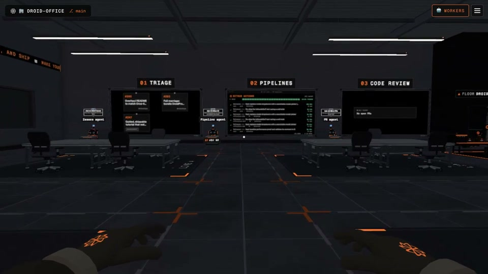
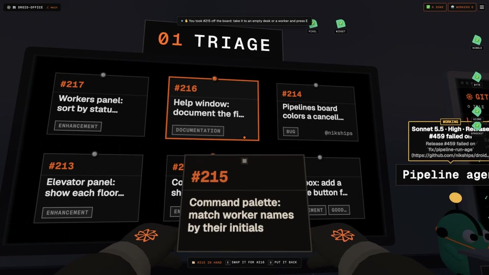
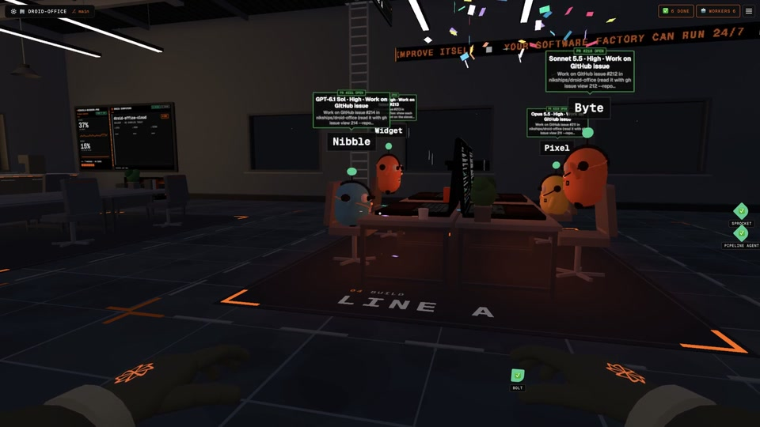
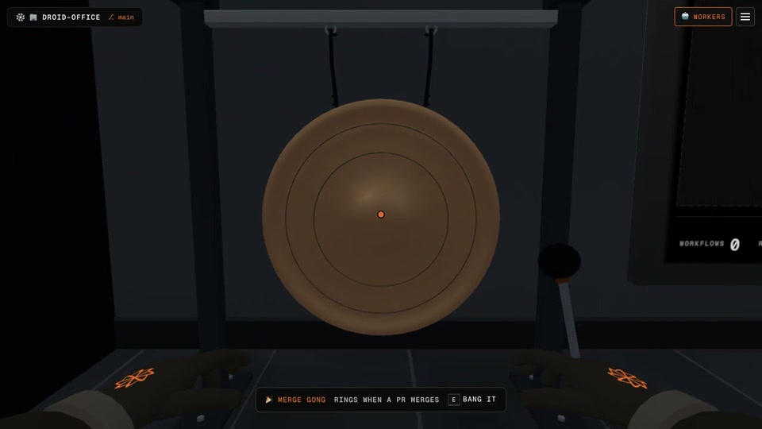
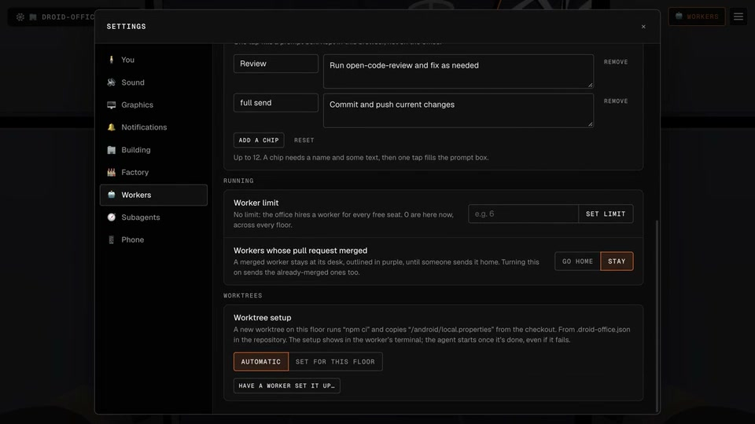
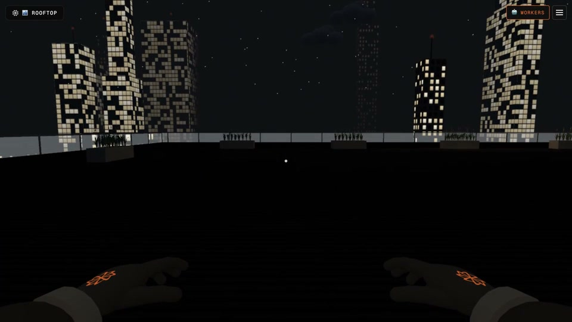
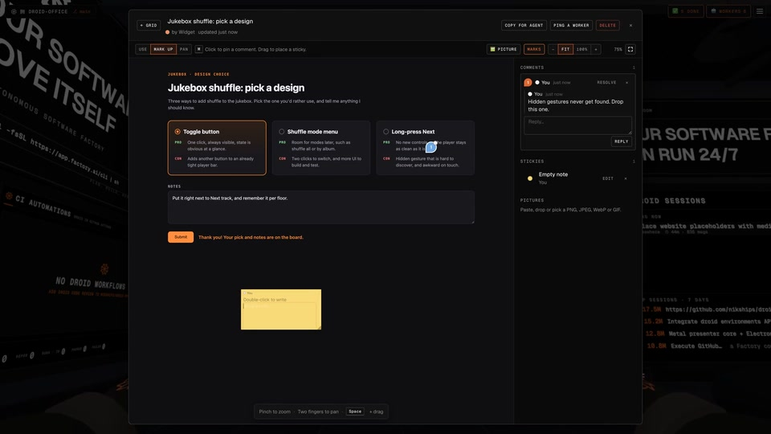
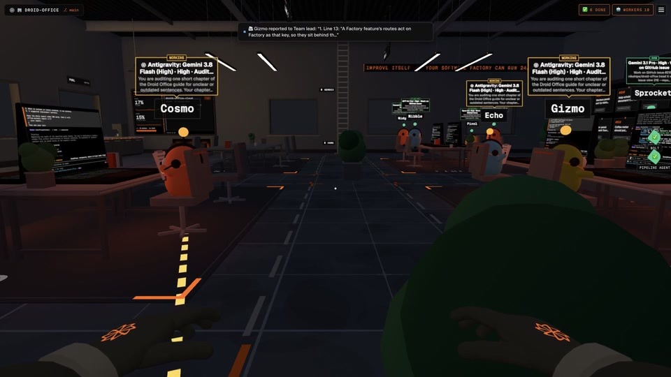

# The office, without the motion

Static frames from the README's real-office captures. [Back to the README](../../../README.md).

## The office floor

## Physical issue cards

## Worker status

## The merge gong

## Worktree setup

## Floors and the rooftop

## Shared Whiteboard

## Team leads and subagents

