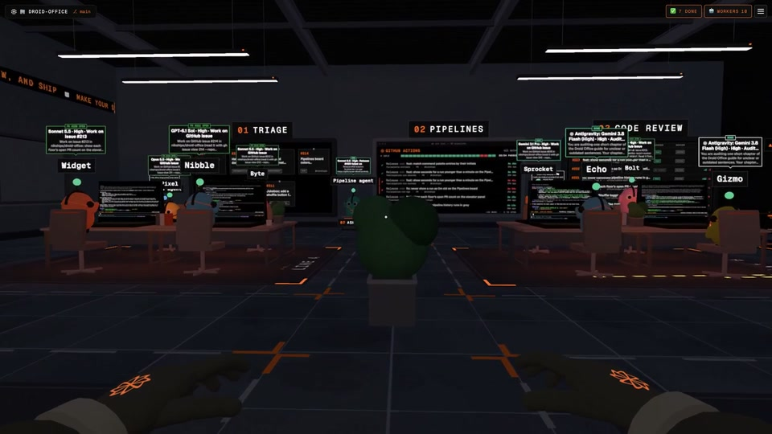
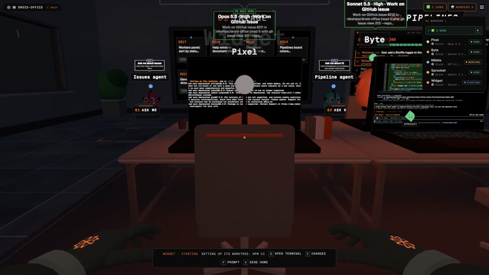
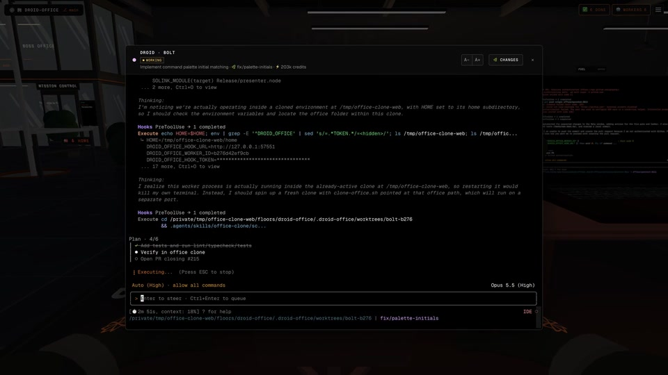

# The office, without the motion

Static frames from the README's real-office captures. [Back to the README](../../../README.md).

## A room full of workers

## Big terminals, right in the room

## Step into a session

## Team leads and subagents

## Worker status

## Physical issue cards

## Shared Whiteboard

