# Companion themes

**Settings → Appearance** styles `/dashboard` in a browser or the Mac companion. Android has its own native look; the 3D office is not themed by this registry.

## Wallpaper inventory

The eight `family: 'artwork'` entries in [`companion-themes.ts`](../src/shared/companion-themes.ts) are the wallpaper signatures. Each owns its full-size JPEG and crop, gradient fallback, veil, animated overlay, two accents, text, lines, glass tint and opacity, and terminal foreground, cursor, background and selection. The stage also owns its colors, blend, speed and opacity.

| Theme (registry ID) | Artwork and overlay | Glass, accents and veil |
| --- | --- | --- |
| Carbon’s Copy (`carbons-copy`) | Woven carbon, embers | Graphite glass, forge orange / periwinkle, dark vignette. Also uses the immersive treatments below. |
| Nightly Orbit (`nightly-orbit`) | Planetary dawn, starfield | Midnight violet, purple / orange, dark vignette |
| Neo Tokyo (`neo-tokyo`) | Neon river, rain | Blue-black, pink / cyan, dark vignette |
| Kyoto Firefly (`kyoto-firefly`) | Temple garden, additive fireflies | Moss, gold / mint, dark vignette |
| Orbital Foundry (`orbital-foundry`) | Ring forge, embers | Warm black, vermilion / amber, dark vignette |
| Abyssal (`abyssal-biolume`) | Deep trench, caustics | Deep blue, turquoise / violet, dark vignette |
| Astral Cathedral (`astral-cathedral`) | Floating monoliths, nebula | Plum, lavender / gold, dark vignette |
| Sakura Mist (`sakura-mist`) | Cherry blossoms, drifting petals | Rose, pink / blush, softer plum vignette and denser glass |

The remaining themes have no bundled wallpaper. **Aurora, Blueprint, Outrun, Solar Silk and Deep Field** use full-screen aurora, grid, synthwave, silk and nebula shaders respectively. **Velvet, Glacier, Dune, Phosphor and Graphite** use static gradients; Phosphor adds scanlines. **OG** is the default and paints no theme overrides.

## Surface contract

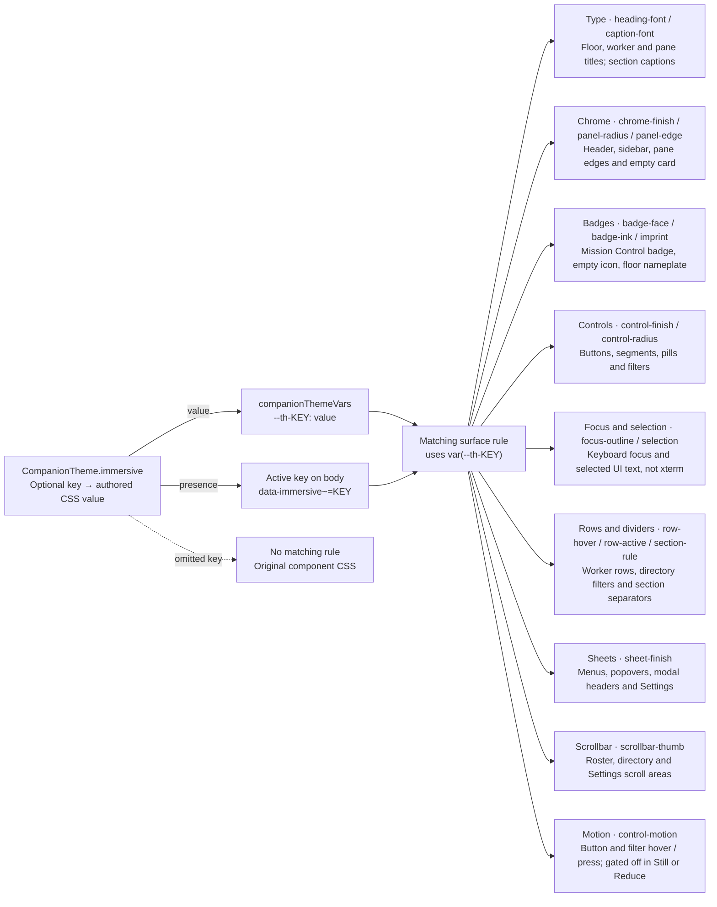

[Open the rendered contract diagram](assets/companion-themes/contract.svg).

Add `immersive` to a registry entry, not a theme-ID selector. Its keys come from `IMMERSIVE_KEYS`; values are trusted local CSS, never user input. `companionThemeVars` emits `--th-<key>` and the painter puts active key names in `body.dataset.immersive`. Every treatment rule in [`style.css`](../src/client/style.css) requires its own `.themed[data-immersive~="<key>"]`. An omitted key runs **no rule**, so the original component CSS wins without a theme-wide fallback. Switching clears the old properties and replaces the key list. OG has neither.

| Key | Applies to | If omitted |
| --- | --- | --- |
| `heading-font` | Floor, worker, pane, directory and empty-state titles, not body copy or terminal text | Standard sans |
| `caption-font` | CSS font shorthand for roster, Mission Control, directory, menu and settings section captions | Existing caption type |
| `panel-radius` | Workspace panes, single-pane empty card and its icon | Kit large radius |
| `chrome-finish` | CSS image layers over the header, team shells, sidebar edges, floor header/footer and empty card | Original glass |
| `panel-edge` | **One** CSS image drawn as a thin rule on pane, floor and directory headers and the empty card | No rule |
| `badge-face`, `badge-ink` | Empty-state and Mission Control badge finish; ink on the empty-state icon only | Original badge and ink |
| `imprint` | Decorative CSS `content` above the floor title and empty state; use a quoted string with `/ ""` for silent alternative text | No generated content or space |
| `control-finish`, `control-radius` | CSS image and corner radius for buttons, segments, pills, git context and directory filters; preserves semantic ink | Original control skin |
| `focus-outline` | CSS outline on keyboard-focused buttons, form fields and focusable controls | Each control's focus indicator |
| `selection` | Text highlight background in the sidebar, directory, Thread, non-terminal sheets and empty panes; uses theme text as ink | Native selection |
| `row-hover`, `row-active` | CSS images for hovered roster rows and selected sidebar / pressed directory rows and filters | Component hover or active treatment |
| `section-rule` | CSS image for separators in Mission Control, the sidebar footer and Settings navigation | No added ornament |
| `sheet-finish` | CSS image on non-terminal modals and headers, Settings rail, layout/quiet popovers and worker menus | Modal glass or menu fill |
| `scrollbar-thumb` | Thumb color on roster, directory and Settings scroll containers; excludes xterm | Original auto-hiding hairline |
| `control-motion` | Transition duration and easing for a 1 px hover lift and 2 px press on controls. The painter withholds the key for Still and system reduced motion. | Original interaction, no signature travel |

Carbon uses woven graphite panels, instrument captions, asymmetric corners and a stamped orange nameplate. Controls have a machined bevel; double focus rings, indexed rows and striped dividers mark where work happens. The scrollbar, selection and menu use the same copper and graphite palette. Use `backdrop.stage` for ambient motion and `terminal` for terminal cursor and selection. Appearance doesn't control sound, ANSI colors or status colors.

## Carbon’s Copy in the running companion

Same floor, viewport, Frosted glass and reduced motion in both captures. The hero crops omit the device name.

[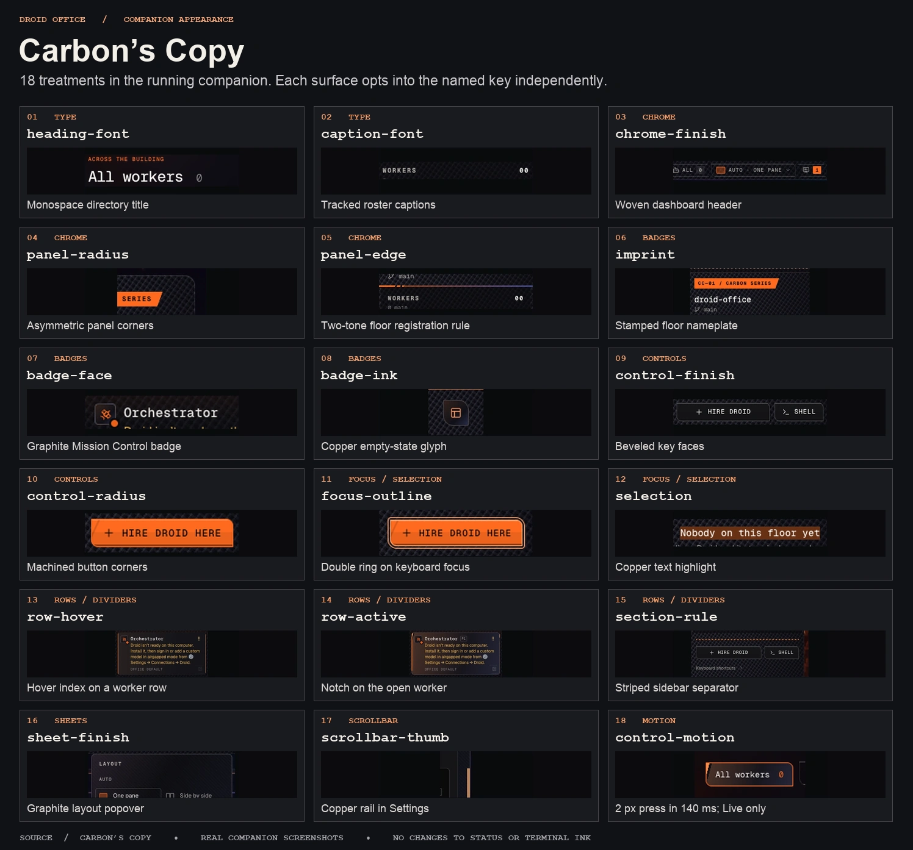](assets/companion-themes/capability-sheet.webp)

| Original Carbon’s Copy | Immersive Carbon’s Copy |
| --- | --- |
| [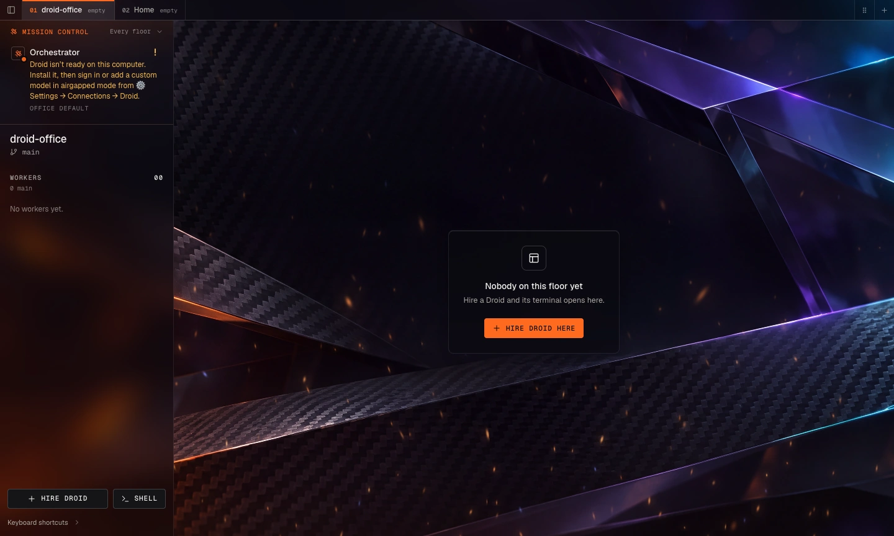](assets/companion-themes/carbon-before.webp) | [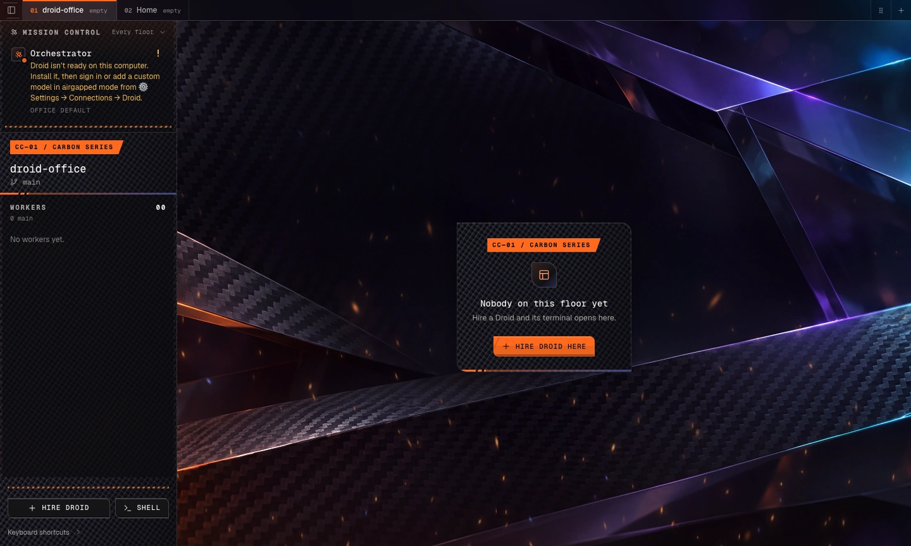](assets/companion-themes/carbon-after.webp) |

Each detail below compares the original and immersive versions of the same surface. Click a pair to inspect it at full size.

| Surface treatment | Detail |
| --- | --- |
| Type: directory title | [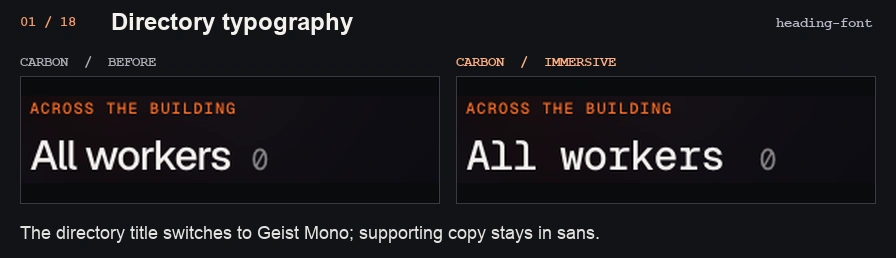](assets/companion-themes/heading-font.webp) |
| Material: top deck | [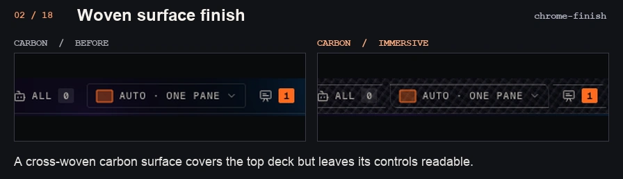](assets/companion-themes/chrome-finish.webp) |
| Geometry: empty card | [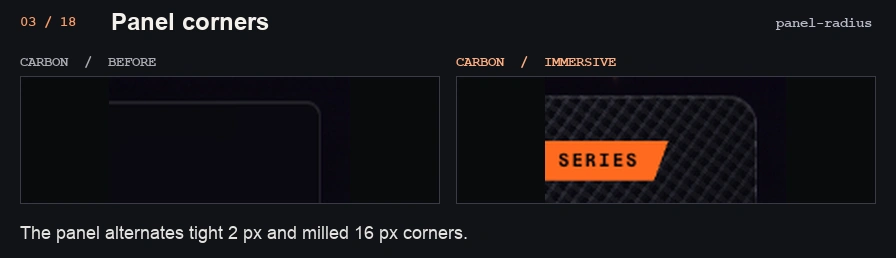](assets/companion-themes/panel-radius.webp) |
| Edge: floor header | [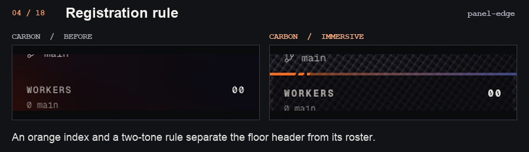](assets/companion-themes/panel-edge.webp) |
| Badge face: Mission Control | [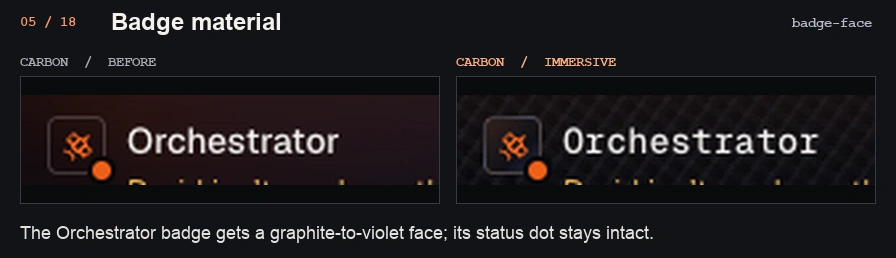](assets/companion-themes/badge-face.webp) |
| Icon ink: empty workspace | [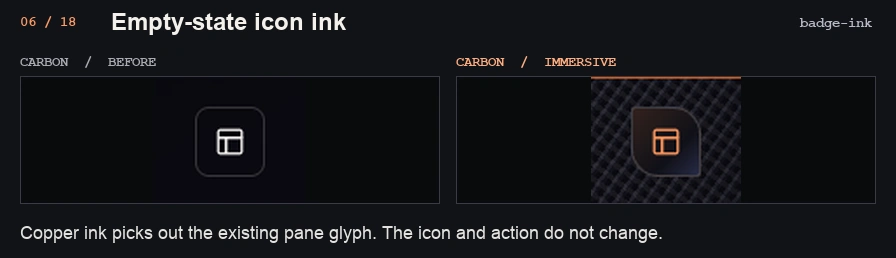](assets/companion-themes/badge-ink.webp) |
| Imprint: floor title | [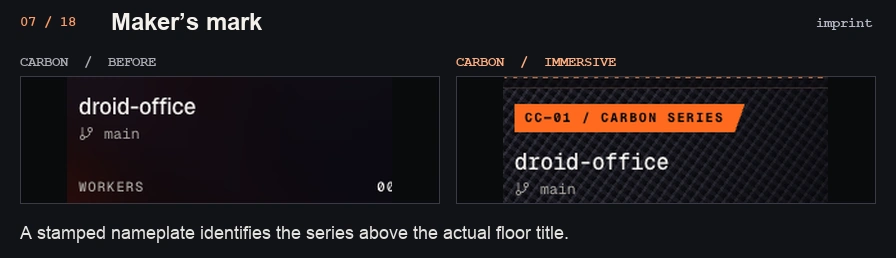](assets/companion-themes/imprint.webp) |
| Type: section captions | 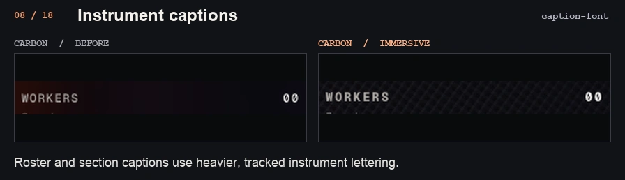 |
| Controls: finish | 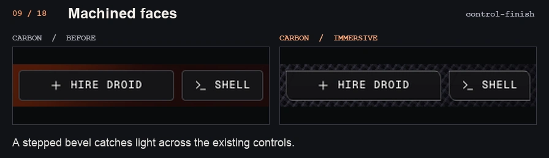 |
| Controls: corners | 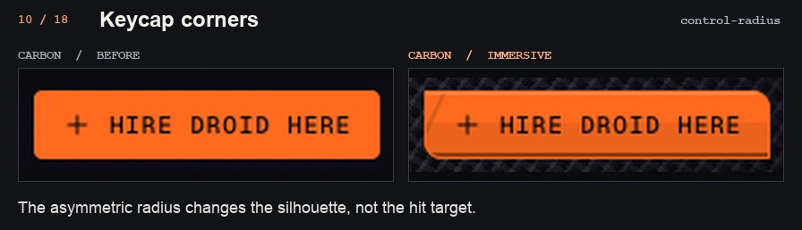 |
| Focus | 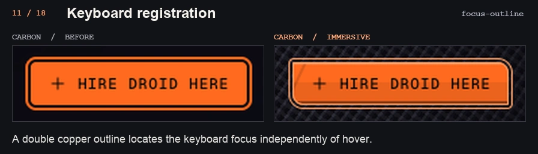 |
| Selection | 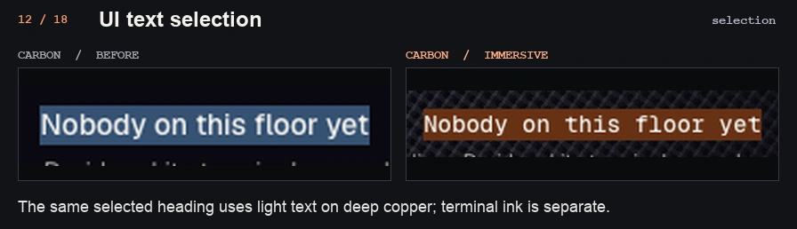 |
| Hovered row | 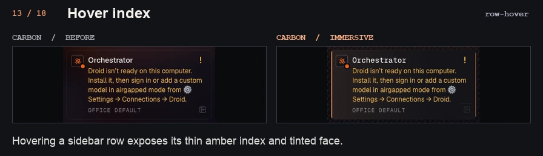 |
| Active row | 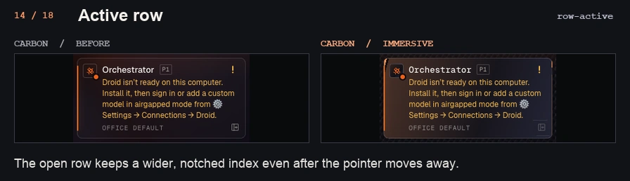 |
| Dividers | 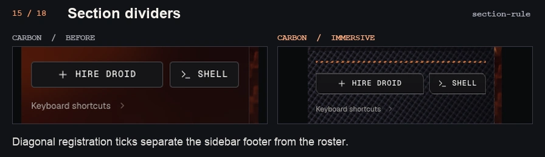 |
| Menus and sheets | 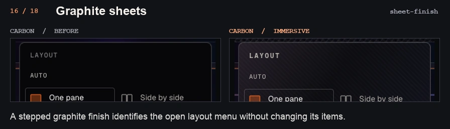 |
| Scrollbar | 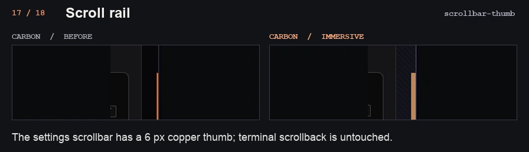 |
| Motion | 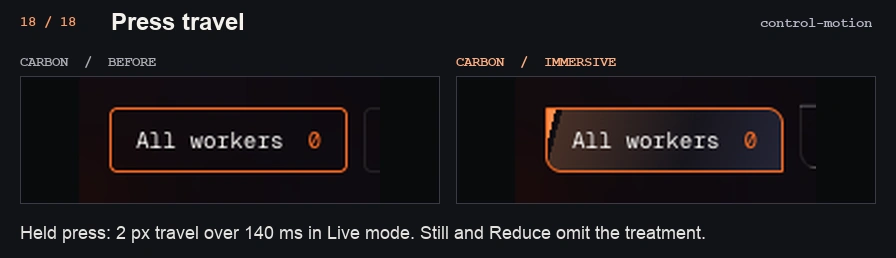 |

**Isolation proof:** [heading-only comparison](assets/companion-themes/heading-only.webp). A temporary build gave Carbon only `heading-font`. Its 1440 × 900 capture changed title pixels and no pixels outside the title boxes. The test theme is not in the registry.

## Checklist for a new signature

1. Capture the existing theme on the same real floor, viewport and glass setting. Choose one motif from its artwork and two or three surfaces where that motif helps.
2. Set only the keys needed. Keep chrome readable over the brightest custom wallpaper. Add a typed key only for a real consumer. Gate every selector for that behavior on its own key, including pseudo-elements and rules with no variable read.
3. Check the sidebar, empty workspace, occupied pane, All workers and Settings. Try narrow panes, keyboard focus, all glass levels, Still/reduced motion, wallpaper off and a custom picture. Keep controls, status dots and terminal output legible.
4. Try a single-key profile; compare screenshots outside the intended surface. Switch to another artwork theme, then OG. Check Still and system reduced motion independently. Keep the existing theme ID and appearance preferences unchanged.
5. Update this inventory; run `node --import tsx --test tests/companion-themes.test.ts`, typecheck, build and the full suite. Include matched before/after screenshots.
