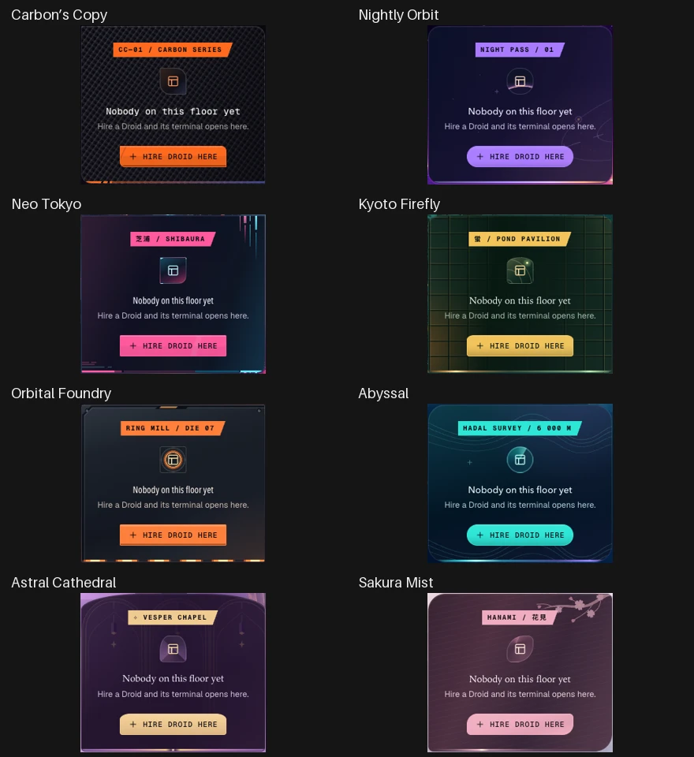

# Companion themes

**Settings → Appearance** styles `/dashboard` in a browser or the Mac companion. Android has its own native look; the 3D office is not themed by this registry. Android's **Appearance** sheet ports the eight artworks and the Glass levels (the same `glassAlpha`, `chromeAlpha` and `pictureShade` math in `core/Appearance.kt`), Wallpaper (artwork or none, with Dim and Blur) and Motion; it has no custom picture, and its glass changes opacity only, without a backdrop blur.

The iOS companion compiles this same Compose sheet and backdrop, bundles the Android WebPs and Geist fonts, and honors iOS Reduce Motion. The wallpaper sits beneath the native terminal: on a themed phone it shows through Raw TTY with the worker pane’s glass tint. Original keeps the black terminal, and explicit terminal program backgrounds stay opaque.

## Signature themes

The eight `family: 'artwork'` entries in [`companion-themes.ts`](../src/shared/companion-themes.ts) are the wallpaper signatures. Each owns its full-size JPEG and crop, gradient fallback, veil, animated overlay, two accents, text, lines, glass tint and opacity, and terminal foreground, cursor, background and selection. The stage also owns its colors, blend, speed and opacity.

| Theme (registry ID) | Artwork and signature surfaces | Running companion: comparison and detail |
| --- | --- | --- |
| Carbon’s Copy (`carbons-copy`) | Woven carbon and embers; graphite floor plate and a copper maker’s mark | [Shipped](assets/companion-themes/carbon-shipped.webp) · [Restrained](assets/companion-themes/carbon-restrained.webp) |
| Nightly Orbit (`nightly-orbit`) | Planetary dawn and stars; orbital charts and a night-pass station plate | [Before](assets/companion-themes/nightly-orbit/before.webp) · [After](assets/companion-themes/nightly-orbit/after.webp) · [Station](assets/companion-themes/nightly-orbit/station.webp) · [Layout](assets/companion-themes/nightly-orbit/layout.webp) |
| Neo Tokyo (`neo-tokyo`) | Neon river and rain; pink and cyan reflections on Shibaura glass | [Before](assets/companion-themes/neo-tokyo/before.webp) · [After](assets/companion-themes/neo-tokyo/after.webp) · [Nameplate](assets/companion-themes/neo-tokyo/nameplate.webp) · [Directory](assets/companion-themes/neo-tokyo/directory.webp) |
| Kyoto Firefly (`kyoto-firefly`) | Garden fireflies; backlit shoji, pond lacquer and lantern-gold edges | [Before](assets/companion-themes/kyoto-firefly/before.webp) · [After](assets/companion-themes/kyoto-firefly/after.webp) · [Card](assets/companion-themes/kyoto-firefly/card.webp) · [Layout](assets/companion-themes/kyoto-firefly/sheet.webp) |
| Orbital Foundry (`orbital-foundry`) | Ring forge and embers; a heat-blued floor plate stamped **ORBITAL FOUNDRY**, with a faint straw-to-blue temper sheen and a 3 px temper-color bottom edge. Headings and badges use the standard kit. | [Before](assets/companion-themes/orbital-foundry/before.webp) · [After](assets/companion-themes/orbital-foundry/after.webp) |
| Abyssal (`abyssal-biolume`) | Trench caustics; depth soundings and a luminous survey plate | [Before](assets/companion-themes/abyssal-biolume/before.webp) · [After](assets/companion-themes/abyssal-biolume/after.webp) · [Focus](assets/companion-themes/abyssal-biolume/focus.webp) · [Layout](assets/companion-themes/abyssal-biolume/layout.webp) |
| Astral Cathedral (`astral-cathedral`) | Floating monoliths and nebula; vaulted chapel arches in plum and gold | [Before](assets/companion-themes/astral-cathedral/before.webp) · [After](assets/companion-themes/astral-cathedral/after.webp) · [Card](assets/companion-themes/astral-cathedral/detail.webp) · [Directory](assets/companion-themes/astral-cathedral/directory.webp) |
| Sakura Mist (`sakura-mist`) | Drifting petals; blossom sprigs, silk panels and a Hanami nameplate | [Before](assets/companion-themes/sakura-mist/before.webp) · [After](assets/companion-themes/sakura-mist/after.webp) · [Card](assets/companion-themes/sakura-mist/blossom-card.webp) · [Layout](assets/companion-themes/sakura-mist/layout-sheet.webp) |

**OG** is the Classic theme and the default for new or unrecognized saved theme IDs. It paints no overrides. For artwork themes, **Glass** offers six optical levels from sharpest to opaque (`Crystal`, `Clear`, `Tinted`, `Frosted`, `Smoked`, `Solid`; default `Frosted`) and **Motion** controls whether ambient light moves (Live) or holds one frame (Still).

Live keeps the full device-pixel buffer and follows the display's refresh rate without a frame cap. The stage updates only the clock on steady frames, and the fragment shaders skip particle work outside exact silhouettes or where the light is far below one 8-bit color step. Compare matched frames at the same shader times and measure the running companion at the same resolution, glass level and actual drawn frame rate.

## Restraint Budget

The wallpaper and the floor nameplate identify the theme. The work controls identify what you can do. Start by **deleting** overrides, not by replacing one button skin with another.

Orbital Foundry omits `heading-font`, `badge-face` and `badge-ink` and uses the kit defaults for those surfaces; the other seven artwork themes use the treatments below.

| Surface | Budget for all eight artwork themes |
| --- | --- |
| Sidebar floor / branch / theme card | `.dash-side-head` uses `chrome-finish` for the base material, `panel-edge` for its 3 px bottom edge, `imprint` on `::before` and `heading-font` on `.dash-side-title`. Each animated theme pairs that nameplate with a bespoke, GPU-composited inline SVG scene and bottom-edge shimmer (`src/client/ui/side-card.ts`, gated on `.themed[data-theme="<id>"]`), plus per-theme imprint badge framing. All card motion pauses on a composed still frame when **Motion** is **Still** (`data-motion="still"`) or system reduced motion is enabled. The branch in `.dash-side-sub` keeps its original mono type. Do not reuse the face, edge, imprint or animated card layer on other panels. |
| Wallpaper and small badges | Keep the artwork, crop and backdrop. Preserve `badge-face` on `.dash-mission-mark` and `.dash-empty-icon`, and `badge-ink` on the empty icon. These are separate from the floor nameplate. |
| Headings and section rules | Use `heading-font` on titles only. Prefer kit captions; if `caption-font` is needed use 10–12 px and at most weight 600. At most one optional `section-rule` image per separator, drawn at 1 px and 28% opacity. No textures on body copy. |
| Buttons, segments, filters and rows | **No** `control-finish`, `control-radius`, `control-motion`, `row-hover` or `row-active`. Keep the kit radius and semantic states. Zero added shadows, bevels, images, textures, glows or travel. Use the existing hover/active wash (6% / 9% text in transparent for themed chrome); do not increase saturation on hover. |
| Focus, selection and scrollbars | Keep the component keyboard indicator; no `focus-outline` or double ring. Omit `selection` and `scrollbar-thumb` unless one flat color is needed. Verify selected text at ≥4.5:1. No custom scrollbar width or always-visible thumb. Never recolor terminal selection through these keys. |
| Sheets, panels and edges | No `sheet-finish`, `panel-radius` or decorative edge outside the nameplate. Use existing glass and a single kit hairline. No gradient, shadow stack or ornamental corners. |

**Carbon’s Copy is the reference:** woven carbon and copper stay on the wallpaper and the maker’s plate. Buttons, filter states, panels, menus, focus, selection and scrollbars use their component defaults.

## Surface contract

Add an optional entry under `CompanionTheme.immersive`, not a theme-ID selector. [`IMMERSIVE_KEYS`](../src/shared/companion-themes.ts) lists the supported keys. Both the body’s `data-immersive` list and its `--th-<key>` variables use this list. Every [CSS treatment](../src/client/style.css) requires its own `.themed[data-immersive~="<key>"]` gate. Omitted and retired keys run no rule. Switching clears old variables and gates; OG has neither.

The previous [field guide](assets/companion-themes/capability-sheet.webp) and gallery comparisons above show the original immersive designs, **not** targets for new controls. Use `backdrop.stage` for ambient motion and `terminal` for terminal cursor and selection. Appearance doesn’t control sound, ANSI colors or status colors.

## Checklist for a new signature

1. Capture the existing theme on the same real floor, viewport and glass setting. Choose one motif from its artwork and two or three surfaces where that motif helps.
2. Set only the keys needed. Keep chrome readable over the brightest custom wallpaper. Add a typed key only for a real consumer. Gate every selector for that behavior on its own key, including pseudo-elements and rules with no variable read.
3. Check the sidebar, empty workspace, occupied pane, All workers and Settings. Try narrow panes, keyboard focus, all glass levels, Still/reduced motion, wallpaper off and a custom picture. Keep controls, status dots and terminal output legible.
4. Try a single-key profile; compare screenshots outside the intended surface. Switch to another artwork theme, then OG. Check Still and system reduced motion independently. Keep the existing theme ID and appearance preferences unchanged.
5. Update this inventory; run `node --import tsx --test tests/companion-themes.test.ts`, typecheck, build and the full suite. Include matched before/after screenshots.
